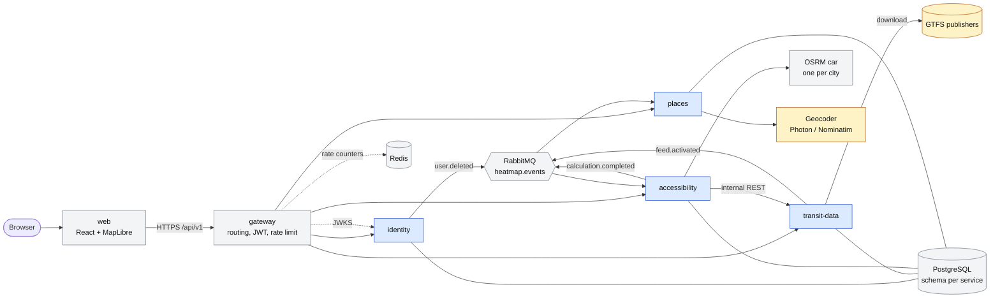
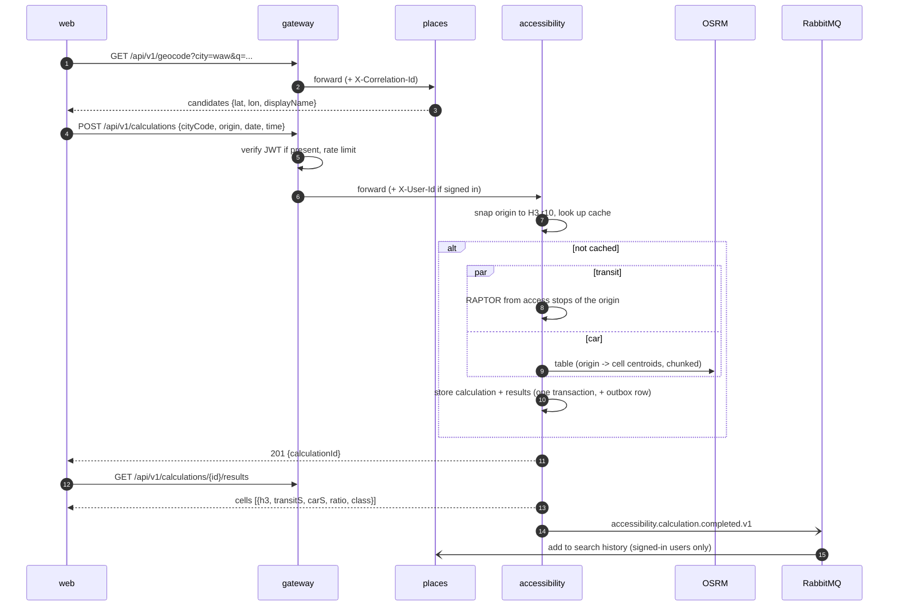
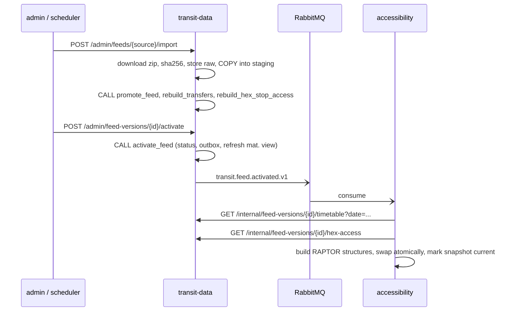
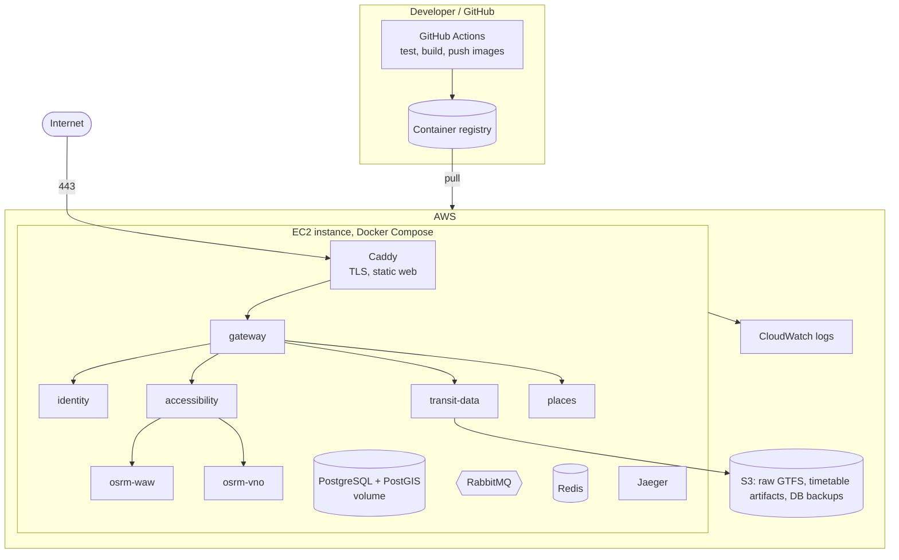

# 2. Architecture

## Services

Four business services, each with its own data and its own reason to change. Frontend, gateway,
database and broker are not counted as business services.

| Service | Business capability | Owns (schema) | Talks to |
| --- | --- | --- | --- |
| `identity` | Accounts, sign-in, tokens, account deletion | `identity` | publishes `identity.user.deleted.v1` |
| `transit-data` | Timetable lifecycle: download GTFS, validate, normalise, build the hexagon grid and access stops, activate a version | `transit`, `transit_staging` | publishes `transit.feed.activated.v1` |
| `accessibility` | The core calculation: transit times (RAPTOR), car times (OSRM), ratio per cell, calculation cache | `accessibility` | calls `transit-data` (internal API), OSRM; consumes `transit.feed.activated.v1`; publishes `accessibility.calculation.completed.v1` |
| `places` | Addresses: geocoding with cache, saved places, search history | `places` | calls a geocoder; consumes `accessibility.calculation.completed.v1`, `identity.user.deleted.v1` |

Supporting components: `gateway` (single public entry point), `web` (frontend), PostgreSQL,
RabbitMQ, Redis, OSRM (one instance per city), Jaeger.

### Why this split

- **Different rates of change and load.** Timetable import is a heavy batch job that runs a few
  times a month. Calculations are CPU-bound, memory-heavy (timetable in RAM) and run on every
  user request. Accounts and saved places are small CRUD. Each can be scaled, deployed and
  restarted without the others: a failed import must not take the map down.
- **Different data ownership.** Timetable data is public and replaceable; account data is
  personal and must be erasable. Keeping them in separate schemas with separate roles means a
  bug or leak in the calculation service cannot reach emails or password hashes.
- **Clear contracts.** `accessibility` needs exactly two things from `transit-data`: a timetable
  for a date and the access stops of each cell. `places` needs nothing from `identity` except
  the user id in the token. Small interfaces are what makes the split cheap.
- **Rejected alternatives.** (a) A monolith with modules: simpler, but an import or a memory
  spike in routing would affect sign-in, and the grading criterion requires services. (b) A
  separate geocoding service and a separate history service: too thin, they would be CRUD
  wrappers; grouped into `places` by the business concept "address". (c) Routing split into a
  transit service and a car service: both are steps of one calculation and would need a
  distributed transaction for one result.

## Container diagram

## Main flow: map for an address

## Timetable update flow

## API gateway

A thin Fastify application: no business logic, no database.

| Concern | Behaviour |
| --- | --- |
| Routing | Public prefix `/api/v1`. Route table in `docs/04-contracts.md`. `/internal/*` paths of services are never exposed. |
| Authentication | Verifies the access token (JWT, asymmetric signature) against the JWKS of `identity`, cached with refresh on unknown `kid`. |
| Authorization | Per route: `public`, `user`, `admin`. On success sets `X-User-Id` and `X-User-Role` for the service; always strips these headers from incoming requests. Services trust them because only the gateway can reach services on the internal network. Services still check ownership (a user reads only own places). |
| Rate limiting | Redis-backed fixed window, keyed by user id when signed in, otherwise by client IP. Limits per route group (table in `04-contracts.md`). Response `429` with `Retry-After`. |
| Correlation | Generates `X-Correlation-Id` (UUID) if the client sent none; forwards it and returns it in the response. Starts the trace. |
| Resilience | Per-upstream timeout and circuit breaker; `503` problem response when open. |
| Other | CORS for the web origin, request size limit, security headers, aggregated `/health/ready`. |

## Cross-cutting rules for every service

| Topic | Rule |
| --- | --- |
| Health | `GET /health/live` (process is up) and `GET /health/ready` (database, broker and required upstreams reachable; for `accessibility` also "a current timetable is loaded"). |
| Logs | JSON to stdout via pino. Required fields: `time`, `level`, `service`, `correlation_id`, `trace_id`, `msg`. Never log passwords, tokens, emails or full addresses. |
| Correlation ID | Read from `X-Correlation-Id`, kept in `AsyncLocalStorage`, added to every log line, outgoing HTTP call and published message (`correlationId` in the envelope). Consumers restore it before handling a message. |
| Tracing | OpenTelemetry SDK with auto-instrumentation for HTTP, `pg` and `amqplib`; W3C `traceparent` over HTTP and in message headers; OTLP export to Jaeger. Manual spans around RAPTOR, OSRM batch and GTFS import stages. |
| Errors | `application/problem+json` (RFC 9457) with `type`, `title`, `status`, `detail`, `correlationId`. |
| Config | Environment variables only, validated at start (fail fast). |
| Shutdown | On SIGTERM: stop accepting, finish in-flight requests and message handlers, close pools. |
| Database | One pool per service, role `svc_<name>`, statement timeout set, all multi-statement changes in a transaction. |

## Resilience patterns

| Pattern | Where |
| --- | --- |
| Timeout | Every outgoing HTTP call and every database statement. |
| Retry with backoff and jitter | Idempotent GETs to `transit-data`, OSRM and the geocoder; GTFS download. Never on POST without an idempotency key. |
| Circuit breaker | `accessibility` -> OSRM, `places` -> geocoder, gateway -> each service. |
| Bulkhead | `accessibility` runs at most N calculations at once (N = CPU cores); extra requests wait in a bounded queue, then get `503` with `Retry-After`. |
| Fallback | Geocoder down: answer from `geocode_cache` only. OSRM down: calculation fails with a clear error instead of showing wrong car times; cached maps keep working. New timetable fails to load: keep serving the previous snapshot. |
| Transactional outbox | A state change and its event are written in one database transaction; a publisher loop sends unpublished rows with publisher confirms. |
| Idempotent consumer | `processed_messages` table: message id inserted in the same transaction as the effect; duplicates are acknowledged and skipped. |
| Dead-letter queue | After 5 failed deliveries a message goes to `heatmap.dlx`; alert via log. |
| Single flight | Unique partial index on the calculation cache key: the same question in parallel is computed once. |

Library: `cockatiel` (timeout, retry, breaker, bulkhead policies) wrapped in `packages/common`.

## Deployment

Local development and the demo run on Docker Compose. Target cloud deployment (phase 10) is one
AWS EC2 instance running the same images with Compose, which fits the free-tier budget; the
images are built and pushed by CI.

Only ports 80/443 are open. Everything else is on the internal Compose network. Upgrade path if
there is budget: RDS for PostgreSQL, ECS Fargate per service.

## Decisions

| # | Decision | Reason | Alternative kept in mind |
| --- | --- | --- | --- |
| D1 | One PostgreSQL instance, schema + role per service | Real isolation (privileges) at the cost of one container; separate instances add cost without adding evidence | Database per service if a service needs different tuning |
| D2 | SQL-first migrations (node-pg-migrate, `.sql` files) and Kysely instead of an ORM-managed schema | Roles, triggers, procedures, PostGIS types and masked views must be written in SQL anyway; one source of truth | Prisma with `db pull` for the client only |
| D3 | Fastify | Schema validation, pino logging and request ids are built in; close to Express in style | Express 5 |
| D4 | RabbitMQ | Topic routing, dead-lettering and per-message acknowledgements fit low-volume business events; AsyncAPI has AMQP bindings | NATS JetStream |
| D5 | RAPTOR implemented in TypeScript, timetable in typed arrays | One language across the project; city-size timetables fit in memory | Rust/Go worker if p95 target is missed |
| D6 | Synchronous calculation request with cache; events only for side effects | The user waits for the map anyway; a job queue would add polling without making it faster | Queue + worker pool if calculations exceed the request timeout |
| D7 | H3 indexes stored as text, computed in the application (h3-js) | No extra database extension to build and maintain | `h3-pg` extension |
| D8 | Walking time = straight line x 1.3 at 5 km/h | Cheap, no extra routing engine; stated in the method | OSRM foot profile for access legs |
| D9 | Geocoder behind an interface; public Photon in development with cache and throttling | No paid API; self-hosting is possible later without code changes | Self-hosted Photon or Pelias |
| D10 | Custom thin gateway on Fastify | Routing, JWT and limits are a few plugins; correlation and tracing are the same code as in services | Traefik or Kong with forward-auth |
