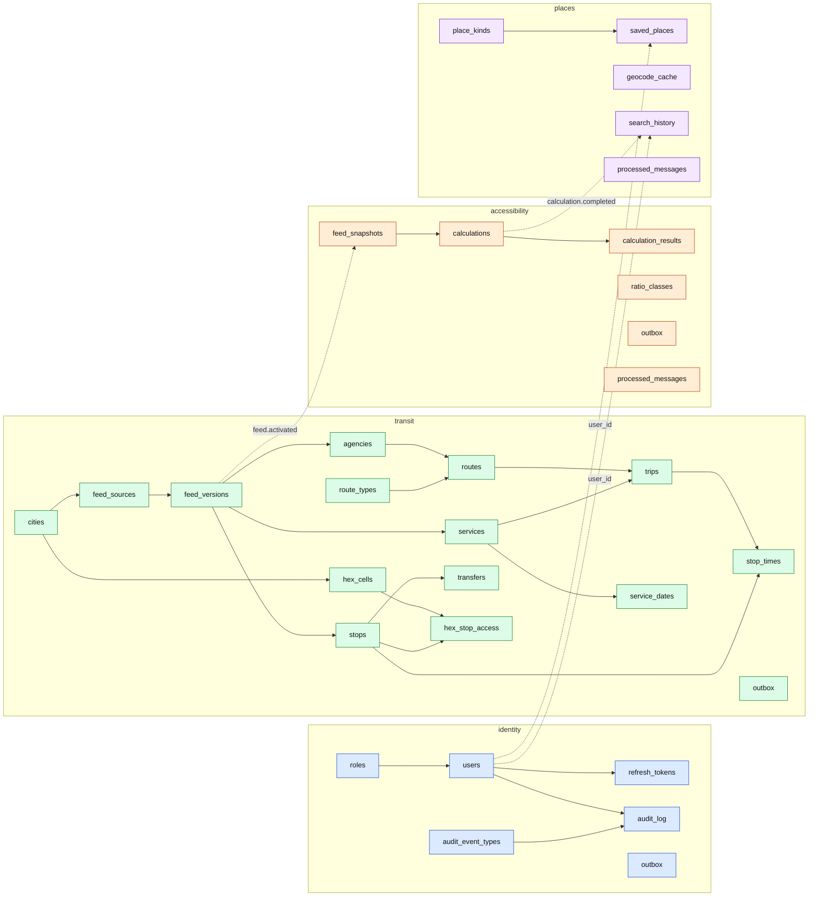

# 3. Database design

DBMS: PostgreSQL 16 with PostGIS (spatial types and nearest-neighbour search for stops and
cells), `citext` (case-insensitive email) and `btree_gist` (exclusion constraint on legend
ranges). The workload is transactional (OLTP) with one batch import path.

The executable source of truth is SQL:

| Path | Content | Run as |
| --- | --- | --- |
| `db/bootstrap/001_roles_schemas.sql` | extensions, roles, schemas, default privileges | superuser, once |
| `services/identity/migrations/` | schema `identity` | `app_admin` |
| `services/transit-data/migrations/` | schemas `transit`, `transit_staging` | `app_admin` |
| `services/accessibility/migrations/` | schema `accessibility` | `app_admin` |
| `services/places/migrations/` | schema `places` | `app_admin` |
| `db/seed/reference/*.sql` | reference tables (idempotent upserts) | `app_admin` |
| `db/seed/test/seed.ts` | testville feed through staging and procedures, demo and edge-case data (`pnpm db:seed:test`) | `app_admin` |
| `db/tests/smoke.sql` | constraints, triggers, procedures, masking, privileges | superuser on a scratch DB |

`docs/db/data-dictionary.md` is generated from the catalog by `scripts/gen-data-dictionary.sh`
(tables, columns, types, keys, constraints, indexes, triggers, views, routines, privileges and a
Mermaid ER diagram per schema with attributes and keys). `pnpm db:diagrams` renders the logical
schema and the ER diagrams to SVG and PNG in `docs/db/img/` with a local Chrome.

## Logical schema

Colours: blue = identity, green = transit, orange = accessibility, purple = places. Dashed lines
are logical references between services (no foreign key; kept consistent by events).

Relationship types present: one-to-many (users -> refresh_tokens), many-to-many resolved by a
link table (cells and stops through `hex_stop_access`; stops with stops through `transfers`),
self-reference (`refresh_tokens.replaced_by`), composite identifying relationships (all GTFS
tables under `feed_versions`), reference lookups (`roles`, `route_types`, `ratio_classes`,
`place_kinds`, `audit_event_types`).

## Data layers

Layers are used only where the data arrives from outside in bulk: the GTFS import.

| Layer | Where | Purpose |
| --- | --- | --- |
| Raw | Original zip in object storage, one `transit.feed_versions` row with its SHA-256 | Reproducibility: any version can be re-imported; duplicates are detected by hash |
| Staging | `transit_staging.*`, unlogged, all columns text, no constraints | Fast `COPY` of files exactly as published; bad rows are visible instead of failing the load |
| Core | `transit.*` GTFS tables in 3NF with keys and checks | Clean, typed timetable; filled only by `transit.promote_feed()` |
| Mart | `transit.hex_stop_access`, `transit.mv_city_coverage`, timetable artifact served to `accessibility` | Shapes that consumers need, precomputed once per feed version |

User-facing data (accounts, places, calculations) is written directly in its final form; a
staging layer there would add nothing.

## Normalisation (3NF)

- Every table has a primary key; non-key columns depend on the whole key and only on the key.
- GTFS tables use composite keys `(feed_version_id, local_id)`. `feed_version_id` is part of the
  key, so repeating it in child tables is not a transitive dependency, and composite foreign
  keys make a reference from one feed version into another impossible.
- Derived values are not stored: `ratio` and the legend class are computed in
  `accessibility.v_calculation_results`; the city of a calculation follows from its feed
  snapshot; the resolution of a cell follows from its H3 index.
- Lookup values that have attributes of their own live in reference tables (`ratio_classes` has
  bounds and colour). Closed lists without attributes are `CHECK` constraints (feed status).
- JSON is used in one place: `outbox.payload`. It is a message body in transit, its structure
  is defined per event type in `contracts/asyncapi`, and it is never queried by content.

## Integrity and transactions

| Mechanism | Examples |
| --- | --- |
| Primary / foreign keys | All tables; `ON DELETE CASCADE` from a feed version to its timetable and from a calculation to its results |
| `NOT NULL`, `UNIQUE`, `CHECK` | Email format, Argon2id prefix on `password_hash`, `departure_s >= arrival_s`, H3 format through domains, one content hash per feed source |
| Partial unique indexes | One active feed version per source; one current snapshot per city; calculation cache key |
| Exclusion constraint | Legend ranges in `ratio_classes` cannot overlap |
| Domains | `h3_cell`, `city_code`, `gtfs_seconds` |
| Triggers | Feed status machine; calculation status machine; audit of account changes; limit of 20 saved places; history trimmed to 50 rows; `updated_at` |
| Procedures | `promote_feed` (staging to core with quality gates), `activate_feed`, `rebuild_transfers`, `rebuild_hex_stop_access`, `anonymize_user`; functions `purge_expired`, `erase_user` |

Transactions:

- Default isolation `READ COMMITTED`. Each API command is one transaction.
- GTFS import: `COPY` into staging, then `CALL promote_feed` in a single transaction. Any
  failed quality gate raises and rolls everything back; the version is then marked `failed`
  in a separate transaction.
- Activation: `activate_feed` archives the old version, activates the new one, writes the
  outbox event and refreshes the materialized view atomically.
- A calculation row and its results are inserted in one transaction together with the outbox row.
- Consumers insert into `processed_messages` and apply the effect in one transaction.
- Concurrency: `SELECT ... FOR UPDATE` on the feed version during promote/activate;
  `FOR UPDATE SKIP LOCKED` in the outbox publisher and in `purge_expired`; advisory lock per
  user in the saved-places limit trigger.
- Consistency between services is eventual and event-driven; there are no cross-schema foreign
  keys. Orphans are prevented by events (`identity.user.deleted.v1` -> `places.erase_user`).

## Roles and access

| Role | Kind | Rights |
| --- | --- | --- |
| `app_admin` | login, not superuser | Owns schemas and objects, runs migrations and seeds |
| `svc_identity`, `svc_transit`, `svc_accessibility`, `svc_places` | login | Member of the matching `*_rw` group; used by exactly one service |
| `identity_rw`, `transit_rw`, `accessibility_rw`, `places_rw` | group | DML and `EXECUTE` in one schema; `identity_rw` cannot update or delete `audit_log` |
| `app_write` | group | Union of all `*_rw`; for operator tooling, not for services |
| `app_read` | group | Read-only. Full read in `transit` and `accessibility`; in `identity` and `places` only reference tables and masked views |
| `reporting` | login | Member of `app_read` |

Mapping to the required triad: `app_read` = read, `app_write` and the per-service `*_rw` =
write, `app_admin` = admin.

Rules:

- `PUBLIC` has no rights on the database, cannot create in `public`, cannot execute functions.
- New objects get their grants from `ALTER DEFAULT PRIVILEGES` set in bootstrap. A table with
  personal data in `transit` or `accessibility` would be readable by `app_read` by default, so
  personal data is allowed only in `identity` and `places`.
- Passwords of database roles are set from environment variables with SCRAM-SHA-256
  (`scripts/db-set-passwords.sh`).
- The privileges section of the data dictionary is regenerated with every migration and
  reviewed in the pull request.

## Passwords and personal data

- User passwords: Argon2id in the application; the column accepts only `$argon2id$...` strings.
- Refresh tokens: only the SHA-256 of a random 256-bit token is stored.

| Personal data | Protection |
| --- | --- |
| `identity.users.email`, `display_name` | `v_users_masked` (`j***@example.com`, `J***`); raw table not readable by `app_read` |
| `identity.audit_log.ip`, `refresh_tokens.ip` | `v_audit_masked` truncates to /24 or /48; cleared on anonymisation |
| `places.saved_places` (label, address, point) | `v_saved_places_masked`: pseudonymous user, no label or address, coordinates rounded to about 1 km |
| `places.search_history` | `v_search_stats`: aggregates only |
| Origin of a calculation | Stored as an H3 resolution-10 cell without a user id |

Erasure: `CALL identity.anonymize_user(id)` scrubs the account, ends sessions and emits
`identity.user.deleted.v1`; `places` then runs `places.erase_user(id)`.

## Indexes

| Index | Serves |
| --- | --- |
| `users_email_uq` | Sign-in by email; uniqueness |
| `refresh_tokens_user_live_idx` (partial) | "Revoke all sessions of a user" touches only live tokens |
| `audit_log_time_idx`, `calculations_created_idx` (BRIN) | Time-range scans on append-only tables at almost no storage cost |
| `stops_geom_gix`, `hex_cells_centroid_gix` (GiST) | Nearest stops of a cell, stops within a radius |
| `stop_times_stop_idx (feed_version_id, stop_id, departure_s)` | Departures from a stop; building route patterns |
| `trips_route_idx`, `trips_service_idx`, `service_dates_date_idx` | Timetable export for one service date |
| `feed_versions_one_active_uq`, `feed_snapshots_current_uq` (partial unique) | Business rule and fast "what is active" lookup |
| `calculations_cache_uq` (partial unique) | Cache hit lookup and single flight |
| `calculations_expires_idx`, `geocode_cache_expires_idx` | Purging expired rows |
| `outbox_unpublished_idx` (partial) | Publisher reads only pending events |
| `search_history_user_idx (user_id, created_at DESC)` | History page |

`docs/db/query-plans.md` (`pnpm db:plans`) holds `EXPLAIN (ANALYZE, BUFFERS)` output of the main
queries on generated volume data (100k users, 1.2M stop times, 200k calculations, 300k outbox and
history rows) as evidence that the indexes are used. The one sequential scan, the timetable
export over `stop_times`, is deliberate and justified there with a forced-index comparison.

## Views

| View | Purpose |
| --- | --- |
| `identity.v_users_masked`, `identity.v_audit_masked` | Masked access for read-only roles |
| `transit.v_active_feeds` | Current version per source |
| `transit.mv_city_coverage` (materialized) | Grid and network size per active feed; expensive counts, refreshed on activation |
| `accessibility.v_calculation_results` | Ratio and legend class derived at read time |
| `accessibility.v_daily_usage` | Calculations per day with average and p95 duration |
| `places.v_saved_places_masked`, `places.v_search_stats` | Masked and aggregated access |

## Versioning of the structure

- One numbered migration file per change, per service, with an up and a down part. Applied
  migrations are recorded in `<schema>.pgmigrations` (node-pg-migrate, `--schema` and
  `--migrations-schema` set to the service schema).
- Merged migrations are immutable; history is the Git log of the `migrations/` folders.
- CI on every pull request: bootstrap a clean database, migrate up, down, up again, load
  reference data, run `db/tests/smoke.sql`, regenerate the data dictionary and fail on a diff.
- Releases are tagged in Git; the tag identifies the schema version deployed.

## Test data (phase 1)

| Set | Content |
| --- | --- |
| Reference | `db/seed/reference/*.sql` |
| `fixtures/gtfs/testville/` | Synthetic feed of about 12 stops and 4 routes with: a trip past midnight, a calendar exception (removed and added day), a station row that must be skipped, a stop with no trips, two stops close enough for a walking transfer, a circular route |
| `db/seed/test/` | Demo users (one `user`, one `admin`, one anonymised) with Argon2id hashes generated by a script; saved places including a user at the 20-place limit; one expired and one fresh calculation with results covering every legend class; grid cells with and without access stops |
