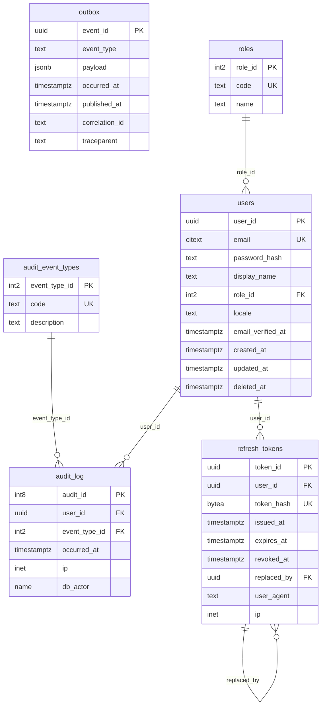
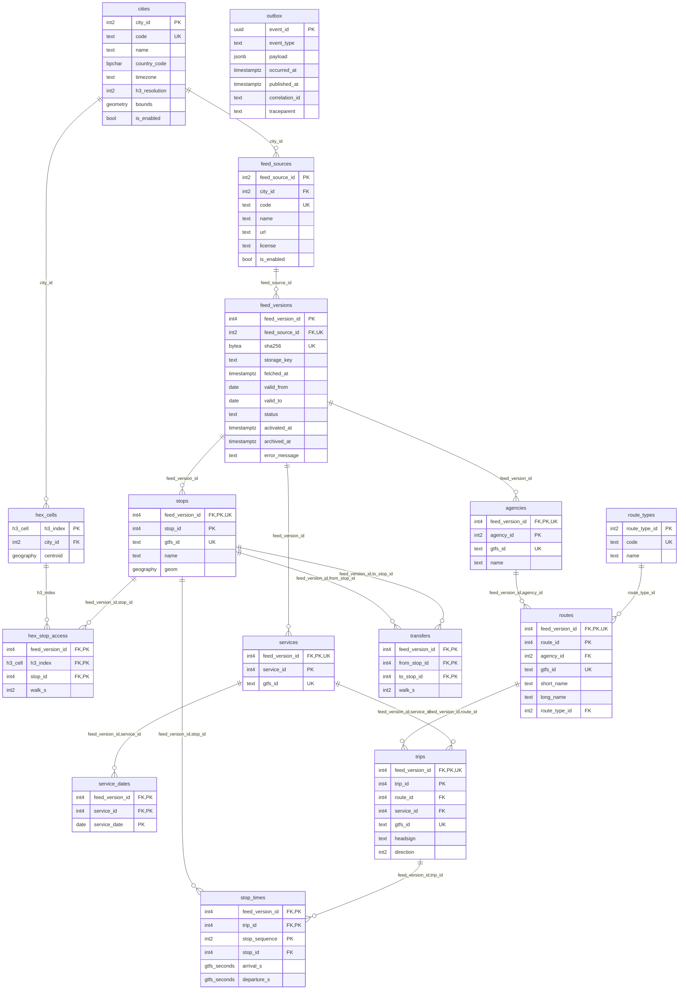
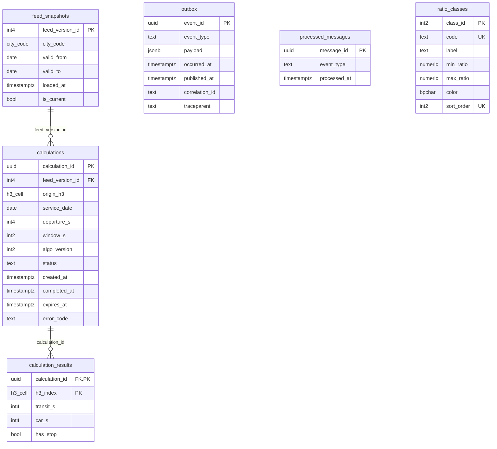
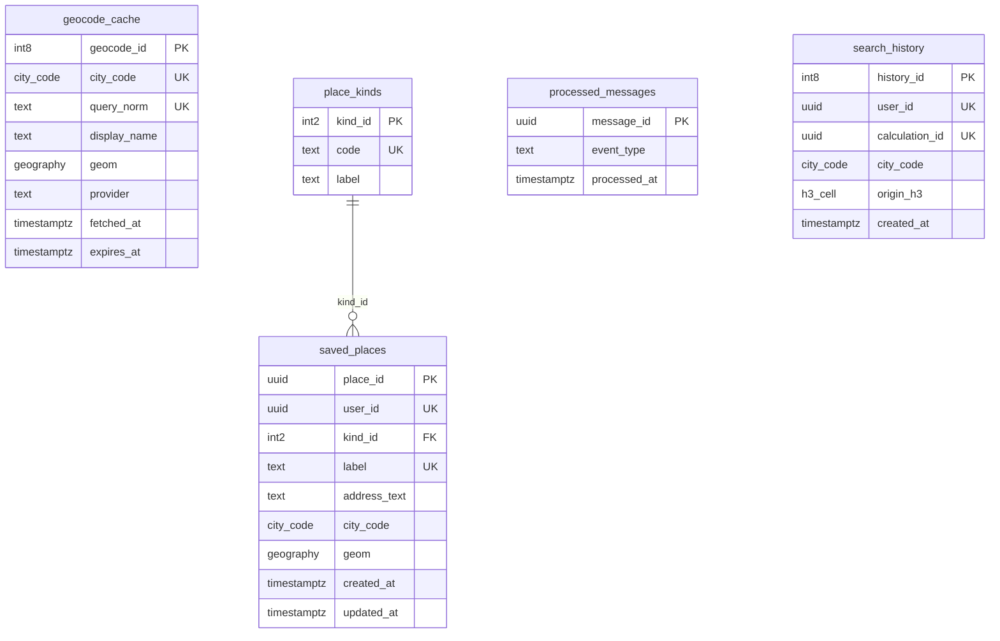

# Data dictionary

Generated by `scripts/gen-data-dictionary.sh` from the database catalog. Do not edit by hand:
change the migration (including `COMMENT ON`) and regenerate.

Key column: PK = primary key, FK = foreign key, UQ = unique. Personal data is marked PII in the description.

## Schema `identity`

Owned by identity-service: accounts, sessions, audit trail.

### `identity.audit_event_types`

Reference: kinds of security-relevant events.

| Column | Type | Null | Default | Key | Description |
| --- | --- | --- | --- | --- | --- |
| event_type_id | smallint | no |  | PK | Stable numeric id referenced by audit_log.event_type_id. |
| code | text | no |  | UQ | Machine name of the event, e.g. login_failed. |
| description | text | no |  |  | What the event means. |

Constraints:

- `audit_event_types_code_check`: CHECK ((code ~ '^[a-z_]+$'::text))
- `audit_event_types_code_key`: UNIQUE (code)

Indexes:

- `identity.audit_event_types_code_key`: btree (code)

### `identity.audit_log`

Append-only security log. Service role can INSERT and SELECT only.

| Column | Type | Null | Default | Key | Description |
| --- | --- | --- | --- | --- | --- |
| audit_id | bigint | no | identity | PK | Sequential id of the entry. |
| user_id | uuid | yes |  | FK | Account the event is about; NULL when unknown (e.g. failed login for an unknown email). |
| event_type_id | smallint | no |  | FK | Kind of event. |
| occurred_at | timestamp with time zone | no | now() |  | When the event happened. |
| ip | inet | yes |  |  | PII. Client address; masked in v_audit_masked, cleared by anonymize_user(). |
| db_actor | name | no | SESSION_USER |  | Database role that wrote the entry (session_user). |

Constraints:

- `audit_log_event_type_id_fkey`: FOREIGN KEY (event_type_id) REFERENCES identity.audit_event_types(event_type_id)
- `audit_log_user_id_fkey`: FOREIGN KEY (user_id) REFERENCES identity.users(user_id) ON DELETE SET NULL

Indexes:

- `identity.audit_log_time_idx`: brin (occurred_at)
- `identity.audit_log_user_idx`: btree (user_id, occurred_at DESC)

### `identity.outbox`

Transactional outbox: events written in the same transaction as the state change.

| Column | Type | Null | Default | Key | Description |
| --- | --- | --- | --- | --- | --- |
| event_id | uuid | no | gen_random_uuid() | PK | Message id; consumers use it for deduplication. |
| event_type | text | no |  |  | Routing key, e.g. identity.user.deleted.v1. |
| payload | jsonb | no |  |  | Event body. JSON is justified: structure is defined per event_type in contracts/asyncapi. |
| occurred_at | timestamp with time zone | no | now() |  | When the state change happened. |
| published_at | timestamp with time zone | yes |  |  | When the broker confirmed the message; NULL = pending. |
| correlation_id | text | yes | NULLIF(current_setting('app.correlation_id'::text, true), ''::text) |  | Correlation id of the request that caused the event (app.correlation_id); NULL for scheduled work. |
| traceparent | text | yes | NULLIF(current_setting('app.traceparent'::text, true), ''::text) |  | W3C trace context of the writing transaction (app.traceparent); the publisher continues this trace. |

Constraints:

- `outbox_correlation_id`: CHECK ((correlation_id ~ '^[A-Za-z0-9._-]{1,128}$'::text))
- `outbox_event_type_check`: CHECK ((event_type ~ '^[a-z]+(\.[a-z_]+)+\.v[0-9]+$'::text))
- `outbox_payload_check`: CHECK ((jsonb_typeof(payload) = 'object'::text))
- `outbox_traceparent`: CHECK ((traceparent ~ '^[0-9a-f]{2}-[0-9a-f]{32}-[0-9a-f]{16}-[0-9a-f]{2}$'::text))

Indexes:

- `identity.outbox_unpublished_idx`: btree (occurred_at) WHERE (published_at IS NULL)

### `identity.pgmigrations`

Migration history of the identity schema, maintained by node-pg-migrate.

| Column | Type | Null | Default | Key | Description |
| --- | --- | --- | --- | --- | --- |
| id | integer | no | nextval('identity.pgmigrations_id_seq'::regclass) | PK | Surrogate key in the order migrations were applied. |
| name | character varying(255) | no |  |  | Migration file name without extension, e.g. 0001_init. |
| run_on | timestamp without time zone | no |  |  | When the migration was applied (server local time). |

### `identity.refresh_tokens`

Rotating refresh tokens (one row per issued token).

| Column | Type | Null | Default | Key | Description |
| --- | --- | --- | --- | --- | --- |
| token_id | uuid | no | gen_random_uuid() | PK | Token row id (also the jti of the refresh token). |
| user_id | uuid | no |  | FK | Owner of the session. |
| token_hash | bytea | no |  | UQ | SHA-256 of a random 256-bit token. The token itself is never stored. |
| issued_at | timestamp with time zone | no | now() |  | When the token was issued. |
| expires_at | timestamp with time zone | no |  |  | After this moment the token is rejected. |
| revoked_at | timestamp with time zone | yes |  |  | Set on rotation, logout or reuse detection; NULL = live. |
| replaced_by | uuid | yes |  | FK | Token issued in exchange for this one on rotation; using a replaced token is reuse. |
| user_agent | text | yes |  |  | Client User-Agent at issue time, for the session list. |
| ip | inet | yes |  |  | PII. Cleared by anonymize_user(). |

Constraints:

- `refresh_tokens_expiry`: CHECK ((expires_at > issued_at))
- `refresh_tokens_hash_len`: CHECK ((octet_length(token_hash) = 32))
- `refresh_tokens_replaced_by_fkey`: FOREIGN KEY (replaced_by) REFERENCES identity.refresh_tokens(token_id) ON DELETE SET NULL
- `refresh_tokens_user_id_fkey`: FOREIGN KEY (user_id) REFERENCES identity.users(user_id) ON DELETE CASCADE
- `refresh_tokens_token_hash_key`: UNIQUE (token_hash)

Indexes:

- `identity.refresh_tokens_expires_idx`: btree (expires_at)
- `identity.refresh_tokens_token_hash_key`: btree (token_hash)
- `identity.refresh_tokens_user_live_idx`: btree (user_id) WHERE (revoked_at IS NULL)

### `identity.roles`

Reference: application roles (seeded from db/seed/reference).

| Column | Type | Null | Default | Key | Description |
| --- | --- | --- | --- | --- | --- |
| role_id | smallint | no |  | PK | Stable numeric id referenced by users.role_id (1 = user, 2 = admin). |
| code | text | no |  | UQ | Machine name used in tokens and access checks (user, admin). |
| name | text | no |  |  | Human-readable name. |

Constraints:

- `roles_code_check`: CHECK ((code ~ '^[a-z_]+$'::text))
- `roles_code_key`: UNIQUE (code)

Indexes:

- `identity.roles_code_key`: btree (code)

### `identity.users`

User accounts. Contains personal data: email, display_name.

| Column | Type | Null | Default | Key | Description |
| --- | --- | --- | --- | --- | --- |
| user_id | uuid | no | gen_random_uuid() | PK | Account id; exposed in tokens and used by other services as a logical reference. |
| email | citext | no |  |  | PII. Case-insensitive, unique. Masked in v_users_masked. |
| password_hash | text | no |  |  | Argon2id PHC string. Plain passwords never reach the database. |
| display_name | text | yes |  |  | PII. Optional name shown in the UI. |
| role_id | smallint | no | 1 | FK | Access level of the account. |
| locale | text | no | 'en'::text |  | Preferred UI language (en, pl, lt, ru). |
| email_verified_at | timestamp with time zone | yes |  |  | When the email address was confirmed; NULL = not confirmed. |
| created_at | timestamp with time zone | no | now() |  | Registration time. |
| updated_at | timestamp with time zone | no | now() |  | Last change of the row; maintained by trigger users_set_updated_at. |
| deleted_at | timestamp with time zone | yes |  |  | Set by anonymize_user(); the row stays as a tombstone without personal data. |

Constraints:

- `users_display_name`: CHECK (((char_length(display_name) >= 1) AND (char_length(display_name) <= 80)))
- `users_email_format`: CHECK ((email ~ '^[^@[:space:]]+@[^@[:space:]]+\.[^@[:space:]]+$'::citext))
- `users_locale`: CHECK ((locale = ANY (ARRAY['en'::text, 'pl'::text, 'lt'::text, 'ru'::text])))
- `users_password_algo`: CHECK ((password_hash ~~ '$argon2id$%'::text))
- `users_role_id_fkey`: FOREIGN KEY (role_id) REFERENCES identity.roles(role_id)

Indexes:

- `identity.users_email_uq`: btree (email)
- `identity.users_role_idx`: btree (role_id)

Triggers:

- `users_audit`: AFTER identity.tg_users_audit
- `users_set_updated_at`: BEFORE identity.tg_set_updated_at

### Views in `identity`

| Name | Kind | Description |
| --- | --- | --- |
| `v_audit_masked` | view | Audit log with IP truncated to /24 (IPv4) or /48 (IPv6). |
| `v_users_masked` | view | Users without readable personal data. The only users relation visible to app_read. |

### Routines in `identity`

| Name | Kind | Description |
| --- | --- | --- |
| `anonymize_user(IN p_user_id uuid)` | procedure | Removes personal data of one user and publishes identity.user.deleted.v1 via the outbox. |
| `mask_email(p_email citext)` | function | jan.kowalski@example.com -> j***@example.com |
| `mask_name(p_name text)` | function | Masks a display name: Jan -> J***. |
| `tg_set_updated_at()` | trigger function | Trigger: sets updated_at to now() on every update. |
| `tg_users_audit()` | trigger function | Trigger: writes one audit_log row for registration, password, role, profile change or anonymisation. |

## Schema `transit`

Owned by transit-data-service: cities, GTFS feed versions, timetable (core layer), H3 grid and access mart.

### `transit.agencies`

Core: GTFS agency.txt of one feed version.

| Column | Type | Null | Default | Key | Description |
| --- | --- | --- | --- | --- | --- |
| feed_version_id | integer | no |  | FK, PK, UQ | Feed version the row belongs to. |
| agency_id | smallint | no |  | PK | Compact id assigned by promote_feed(). |
| gtfs_id | text | no |  | UQ | agency_id from the feed ('default' when the feed leaves it empty). |
| name | text | no |  |  | agency_name from the feed. |

Constraints:

- `agencies_feed_version_id_fkey`: FOREIGN KEY (feed_version_id) REFERENCES transit.feed_versions(feed_version_id) ON DELETE CASCADE
- `agencies_feed_version_id_gtfs_id_key`: UNIQUE (feed_version_id, gtfs_id)

Indexes:

- `transit.agencies_feed_version_id_gtfs_id_key`: btree (feed_version_id, gtfs_id)

### `transit.cities`

Reference: supported cities.

| Column | Type | Null | Default | Key | Description |
| --- | --- | --- | --- | --- | --- |
| city_id | smallint | no |  | PK | Stable numeric id. |
| code | text | no |  | UQ | Three-letter city code used in the API and events (waw, vno). |
| name | text | no |  |  | City name in English. |
| country_code | character(2) | no |  |  | ISO 3166-1 alpha-2 country code. |
| timezone | text | no |  |  | IANA time zone of the timetable, e.g. Europe/Warsaw. |
| h3_resolution | smallint | no | 9 |  | H3 resolution of the destination grid (9 = about 0.1 km2 per cell). |
| bounds | geometry(Polygon,4326) | no |  |  | Area covered by the hexagon grid (WGS 84). |
| is_enabled | boolean | no | true |  | false = hidden from the city list. |

Constraints:

- `cities_bounds_check`: CHECK (st_isvalid(bounds))
- `cities_code_check`: CHECK ((code ~ '^[a-z]{3}$'::text))
- `cities_country_code_check`: CHECK ((country_code ~ '^[A-Z]{2}$'::text))
- `cities_h3_resolution_check`: CHECK (((h3_resolution >= 7) AND (h3_resolution <= 10)))
- `cities_code_key`: UNIQUE (code)

Indexes:

- `transit.cities_code_key`: btree (code)

### `transit.feed_sources`

Reference: where GTFS feeds are downloaded from.

| Column | Type | Null | Default | Key | Description |
| --- | --- | --- | --- | --- | --- |
| feed_source_id | smallint | no |  | PK | Stable numeric id. |
| city_id | smallint | no |  | FK | City served by the feed. |
| code | text | no |  | UQ | Machine name used in admin URLs, e.g. waw_ztm. |
| name | text | no |  |  | Publisher or feed name. |
| url | text | no |  |  | Download URL of the GTFS zip. |
| license | text | no |  |  | Licence or terms of use of the data. |
| is_enabled | boolean | no | true |  | false = excluded from scheduled imports. |

Constraints:

- `feed_sources_code_check`: CHECK ((code ~ '^[a-z0-9_]+$'::text))
- `feed_sources_url_check`: CHECK ((url ~ '^https?://'::text))
- `feed_sources_city_id_fkey`: FOREIGN KEY (city_id) REFERENCES transit.cities(city_id)
- `feed_sources_code_key`: UNIQUE (code)

Indexes:

- `transit.feed_sources_city_idx`: btree (city_id)
- `transit.feed_sources_code_key`: btree (code)

### `transit.feed_versions`

One row per downloaded GTFS archive. At most one active version per source.

| Column | Type | Null | Default | Key | Description |
| --- | --- | --- | --- | --- | --- |
| feed_version_id | integer | no | identity | PK | Surrogate key; part of the key of every core GTFS row. |
| feed_source_id | smallint | no |  | FK, UQ | Source the archive was downloaded from. |
| sha256 | bytea | no |  | UQ | Hash of the zip; the same archive is never imported twice. |
| storage_key | text | no |  |  | Object-storage key of the original zip (raw layer). |
| fetched_at | timestamp with time zone | no | now() |  | When the archive was downloaded. |
| valid_from | date | yes |  |  | First service date; set by promote_feed(). |
| valid_to | date | yes |  |  | Last service date; set by promote_feed(). |
| status | text | no | 'downloaded'::text |  | downloaded -> staged -> validated -> active -> archived, or failed; enforced by trigger feed_versions_status. |
| activated_at | timestamp with time zone | yes |  |  | When the version became active; set by trigger. |
| archived_at | timestamp with time zone | yes |  |  | When the version was archived; set by trigger. |
| error_message | text | yes |  |  | Why the import failed; present exactly when status = failed. |

Constraints:

- `feed_versions_error`: CHECK (((status = 'failed'::text) = (error_message IS NOT NULL)))
- `feed_versions_sha256_check`: CHECK ((octet_length(sha256) = 32))
- `feed_versions_status`: CHECK ((status = ANY (ARRAY['downloaded'::text, 'staged'::text, 'validated'::text, 'active'::text, 'archived'::text, 'failed'::text])))
- `feed_versions_validity`: CHECK ((valid_to >= valid_from))
- `feed_versions_feed_source_id_fkey`: FOREIGN KEY (feed_source_id) REFERENCES transit.feed_sources(feed_source_id)
- `feed_versions_content_uq`: UNIQUE (feed_source_id, sha256)

Indexes:

- `transit.feed_versions_content_uq`: btree (feed_source_id, sha256)
- `transit.feed_versions_one_active_uq`: btree (feed_source_id) WHERE (status = 'active'::text)

Triggers:

- `feed_versions_status`: BEFORE transit.tg_feed_version_status

### `transit.hex_cells`

H3 cells covering each city at cities.h3_resolution. Generated by the service with h3-js.

| Column | Type | Null | Default | Key | Description |
| --- | --- | --- | --- | --- | --- |
| h3_index | transit.h3_cell | no |  | PK | H3 cell index. |
| city_id | smallint | no |  | FK | City whose grid the cell belongs to. |
| centroid | geography(Point,4326) | no |  |  | Cell centre (WGS 84); start and end point of walking and driving legs. |

Constraints:

- `hex_cells_city_id_fkey`: FOREIGN KEY (city_id) REFERENCES transit.cities(city_id)

Indexes:

- `transit.hex_cells_centroid_gix`: gist (centroid)
- `transit.hex_cells_city_idx`: btree (city_id)

### `transit.hex_stop_access`

Mart: nearest stops of every cell with walking time. Recomputed for each feed version.

| Column | Type | Null | Default | Key | Description |
| --- | --- | --- | --- | --- | --- |
| feed_version_id | integer | no |  | FK, PK | Feed version whose stops were used. |
| h3_index | transit.h3_cell | no |  | FK, PK | Cell. |
| stop_id | integer | no |  | FK, PK | One of the nearest stops of the cell. |
| walk_s | smallint | no |  |  | Walking time from the cell centre to the stop, seconds. |

Constraints:

- `hex_stop_access_walk_s_check`: CHECK (((walk_s >= 0) AND (walk_s <= 1800)))
- `hex_stop_access_feed_version_id_stop_id_fkey`: FOREIGN KEY (feed_version_id, stop_id) REFERENCES transit.stops(feed_version_id, stop_id) ON DELETE CASCADE
- `hex_stop_access_h3_index_fkey`: FOREIGN KEY (h3_index) REFERENCES transit.hex_cells(h3_index) ON DELETE CASCADE

### `transit.outbox`

Transactional outbox: events written in the same transaction as the state change.

| Column | Type | Null | Default | Key | Description |
| --- | --- | --- | --- | --- | --- |
| event_id | uuid | no | gen_random_uuid() | PK | Message id; consumers use it for deduplication. |
| event_type | text | no |  |  | Routing key, e.g. transit.feed.activated.v1. |
| payload | jsonb | no |  |  | Event body. JSON is justified: structure is defined per event_type in contracts/asyncapi. |
| occurred_at | timestamp with time zone | no | now() |  | When the state change happened. |
| published_at | timestamp with time zone | yes |  |  | When the broker confirmed the message; NULL = pending. |
| correlation_id | text | yes | NULLIF(current_setting('app.correlation_id'::text, true), ''::text) |  | Correlation id of the request that caused the event (app.correlation_id); NULL for scheduled work. |
| traceparent | text | yes | NULLIF(current_setting('app.traceparent'::text, true), ''::text) |  | W3C trace context of the writing transaction (app.traceparent); the publisher continues this trace. |

Constraints:

- `outbox_correlation_id`: CHECK ((correlation_id ~ '^[A-Za-z0-9._-]{1,128}$'::text))
- `outbox_event_type_check`: CHECK ((event_type ~ '^[a-z]+(\.[a-z_]+)+\.v[0-9]+$'::text))
- `outbox_payload_check`: CHECK ((jsonb_typeof(payload) = 'object'::text))
- `outbox_traceparent`: CHECK ((traceparent ~ '^[0-9a-f]{2}-[0-9a-f]{32}-[0-9a-f]{16}-[0-9a-f]{2}$'::text))

Indexes:

- `transit.outbox_unpublished_idx`: btree (occurred_at) WHERE (published_at IS NULL)

### `transit.pgmigrations`

Migration history of the transit and transit_staging schemas, maintained by node-pg-migrate.

| Column | Type | Null | Default | Key | Description |
| --- | --- | --- | --- | --- | --- |
| id | integer | no | nextval('transit.pgmigrations_id_seq'::regclass) | PK | Surrogate key in the order migrations were applied. |
| name | character varying(255) | no |  |  | Migration file name without extension, e.g. 0001_init. |
| run_on | timestamp without time zone | no |  |  | When the migration was applied (server local time). |

### `transit.route_types`

Reference: GTFS route_type codes (0 tram, 1 metro, 2 rail, 3 bus, ...).

| Column | Type | Null | Default | Key | Description |
| --- | --- | --- | --- | --- | --- |
| route_type_id | smallint | no |  | PK | GTFS route_type value. |
| code | text | no |  | UQ | Machine name of the mode, e.g. tram. |
| name | text | no |  |  | Human-readable name of the mode. |

Constraints:

- `route_types_code_check`: CHECK ((code ~ '^[a-z_]+$'::text))
- `route_types_code_key`: UNIQUE (code)

Indexes:

- `transit.route_types_code_key`: btree (code)

### `transit.routes`

Core: GTFS routes.txt of one feed version.

| Column | Type | Null | Default | Key | Description |
| --- | --- | --- | --- | --- | --- |
| feed_version_id | integer | no |  | FK, PK, UQ | Feed version the row belongs to. |
| route_id | integer | no |  | PK | Compact id assigned by promote_feed(). |
| agency_id | smallint | no |  | FK | Operating agency. |
| gtfs_id | text | no |  | UQ | route_id from the feed. |
| short_name | text | yes |  |  | Line number shown to riders, e.g. 175. |
| long_name | text | yes |  |  | Descriptive line name; at least one of the two names is present. |
| route_type_id | smallint | no |  | FK | Mode of transport. |

Constraints:

- `routes_has_name`: CHECK (((short_name IS NOT NULL) OR (long_name IS NOT NULL)))
- `routes_feed_version_id_agency_id_fkey`: FOREIGN KEY (feed_version_id, agency_id) REFERENCES transit.agencies(feed_version_id, agency_id) ON DELETE CASCADE
- `routes_route_type_id_fkey`: FOREIGN KEY (route_type_id) REFERENCES transit.route_types(route_type_id)
- `routes_feed_version_id_gtfs_id_key`: UNIQUE (feed_version_id, gtfs_id)

Indexes:

- `transit.routes_feed_version_id_gtfs_id_key`: btree (feed_version_id, gtfs_id)

### `transit.service_dates`

Days on which a service runs: calendar.txt expanded, calendar_dates.txt applied.

| Column | Type | Null | Default | Key | Description |
| --- | --- | --- | --- | --- | --- |
| feed_version_id | integer | no |  | FK, PK | Feed version the row belongs to. |
| service_id | integer | no |  | FK, PK | Service that runs on the date. |
| service_date | date | no |  | PK | Local service date (trips may run past midnight of it). |

Constraints:

- `service_dates_feed_version_id_service_id_fkey`: FOREIGN KEY (feed_version_id, service_id) REFERENCES transit.services(feed_version_id, service_id) ON DELETE CASCADE

Indexes:

- `transit.service_dates_date_idx`: btree (feed_version_id, service_date)

### `transit.services`

Core: service ids from calendar.txt and calendar_dates.txt.

| Column | Type | Null | Default | Key | Description |
| --- | --- | --- | --- | --- | --- |
| feed_version_id | integer | no |  | FK, PK, UQ | Feed version the row belongs to. |
| service_id | integer | no |  | PK | Compact id assigned by promote_feed(). |
| gtfs_id | text | no |  | UQ | service_id from the feed. |

Constraints:

- `services_feed_version_id_fkey`: FOREIGN KEY (feed_version_id) REFERENCES transit.feed_versions(feed_version_id) ON DELETE CASCADE
- `services_feed_version_id_gtfs_id_key`: UNIQUE (feed_version_id, gtfs_id)

Indexes:

- `transit.services_feed_version_id_gtfs_id_key`: btree (feed_version_id, gtfs_id)

### `transit.stop_times`

Core: GTFS stop_times.txt, times converted to seconds of the service day.

| Column | Type | Null | Default | Key | Description |
| --- | --- | --- | --- | --- | --- |
| feed_version_id | integer | no |  | FK, PK | Feed version the row belongs to. |
| trip_id | integer | no |  | FK, PK | Trip the call belongs to. |
| stop_sequence | smallint | no |  | PK | Order of the call within the trip (increasing, not necessarily consecutive). |
| stop_id | integer | no |  | FK | Stop served. |
| arrival_s | transit.gtfs_seconds | no |  |  | Arrival, seconds of the service day; may exceed 86400 after midnight. |
| departure_s | transit.gtfs_seconds | no |  |  | Departure, seconds of the service day; not earlier than arrival_s. |

Constraints:

- `stop_times_dwell`: CHECK (((departure_s)::integer >= (arrival_s)::integer))
- `stop_times_stop_sequence_check`: CHECK ((stop_sequence >= 0))
- `stop_times_feed_version_id_stop_id_fkey`: FOREIGN KEY (feed_version_id, stop_id) REFERENCES transit.stops(feed_version_id, stop_id) ON DELETE CASCADE
- `stop_times_feed_version_id_trip_id_fkey`: FOREIGN KEY (feed_version_id, trip_id) REFERENCES transit.trips(feed_version_id, trip_id) ON DELETE CASCADE

Indexes:

- `transit.stop_times_stop_idx`: btree (feed_version_id, stop_id, departure_s)

### `transit.stops`

Core: boarding locations from GTFS stops.txt (stations and entrances are skipped).

| Column | Type | Null | Default | Key | Description |
| --- | --- | --- | --- | --- | --- |
| feed_version_id | integer | no |  | FK, PK, UQ | Feed version the row belongs to. |
| stop_id | integer | no |  | PK | Compact id assigned by promote_feed(); RAPTOR uses it as an array index. |
| gtfs_id | text | no |  | UQ | stop_id from the feed. |
| name | text | no |  |  | stop_name from the feed. |
| geom | geography(Point,4326) | no |  |  | Stop position (WGS 84). |

Constraints:

- `stops_feed_version_id_fkey`: FOREIGN KEY (feed_version_id) REFERENCES transit.feed_versions(feed_version_id) ON DELETE CASCADE
- `stops_feed_version_id_gtfs_id_key`: UNIQUE (feed_version_id, gtfs_id)

Indexes:

- `transit.stops_feed_version_id_gtfs_id_key`: btree (feed_version_id, gtfs_id)
- `transit.stops_geom_gix`: gist (geom)

### `transit.transfers`

Walking links between nearby stops (RAPTOR footpaths). Built by rebuild_transfers().

| Column | Type | Null | Default | Key | Description |
| --- | --- | --- | --- | --- | --- |
| feed_version_id | integer | no |  | FK, PK | Feed version the row belongs to. |
| from_stop_id | integer | no |  | FK, PK | Stop the walk starts at. |
| to_stop_id | integer | no |  | FK, PK | Stop the walk ends at. |
| walk_s | smallint | no |  |  | Walking time in seconds (walk_seconds() of the straight-line distance). |

Constraints:

- `transfers_not_self`: CHECK ((from_stop_id <> to_stop_id))
- `transfers_walk_s_check`: CHECK (((walk_s >= 1) AND (walk_s <= 1800)))
- `transfers_feed_version_id_from_stop_id_fkey`: FOREIGN KEY (feed_version_id, from_stop_id) REFERENCES transit.stops(feed_version_id, stop_id) ON DELETE CASCADE
- `transfers_feed_version_id_to_stop_id_fkey`: FOREIGN KEY (feed_version_id, to_stop_id) REFERENCES transit.stops(feed_version_id, stop_id) ON DELETE CASCADE

### `transit.trips`

Core: GTFS trips.txt of one feed version.

| Column | Type | Null | Default | Key | Description |
| --- | --- | --- | --- | --- | --- |
| feed_version_id | integer | no |  | FK, PK, UQ | Feed version the row belongs to. |
| trip_id | integer | no |  | PK | Compact id assigned by promote_feed(). |
| route_id | integer | no |  | FK | Route the trip runs on. |
| service_id | integer | no |  | FK | Service that decides on which dates the trip runs. |
| gtfs_id | text | no |  | UQ | trip_id from the feed. |
| headsign | text | yes |  |  | Destination shown on the vehicle. |
| direction | smallint | yes |  |  | GTFS direction_id (0 or 1); NULL when the feed omits it. |

Constraints:

- `trips_direction_check`: CHECK ((direction = ANY (ARRAY[0, 1])))
- `trips_feed_version_id_route_id_fkey`: FOREIGN KEY (feed_version_id, route_id) REFERENCES transit.routes(feed_version_id, route_id) ON DELETE CASCADE
- `trips_feed_version_id_service_id_fkey`: FOREIGN KEY (feed_version_id, service_id) REFERENCES transit.services(feed_version_id, service_id) ON DELETE CASCADE
- `trips_feed_version_id_gtfs_id_key`: UNIQUE (feed_version_id, gtfs_id)

Indexes:

- `transit.trips_feed_version_id_gtfs_id_key`: btree (feed_version_id, gtfs_id)
- `transit.trips_route_idx`: btree (feed_version_id, route_id)
- `transit.trips_service_idx`: btree (feed_version_id, service_id)

### Views in `transit`

| Name | Kind | Description |
| --- | --- | --- |
| `mv_city_coverage` | materialized view | Per active feed: grid size, cells with a stop in walking distance, network size. Refreshed by activate_feed(). |
| `v_active_feeds` | view | The feed version currently served for each source. |

### Routines in `transit`

| Name | Kind | Description |
| --- | --- | --- |
| `activate_feed(IN p_fv integer)` | procedure | Makes a validated feed version the active one and publishes transit.feed.activated.v1. |
| `gtfs_time_to_seconds(p_time text)` | function | '25:10:00' -> 90600. Hours may exceed 23. |
| `promote_feed(IN p_fv integer)` | procedure | Staging to core for one feed version: type conversion, key assignment, quality gates. All or nothing. |
| `rebuild_hex_stop_access(IN p_fv integer, IN p_max_m integer, IN p_k integer)` | procedure | For every cell of the feed's city: up to p_k stops within p_max_m metres, with walking time. |
| `rebuild_transfers(IN p_fv integer, IN p_max_m integer)` | procedure | Rebuilds walking transfers between stops of one feed version that are at most p_max_m metres apart. |
| `tg_feed_version_status()` | trigger function | Trigger: allows only legal feed status transitions and stamps activated_at / archived_at. |
| `walk_seconds(p_meters double precision)` | function | Straight-line metres to walking seconds. Single place where the walking model lives in SQL. |

## Schema `transit_staging`

Owned by transit-data-service: GTFS files as loaded, text columns, no constraints (staging layer). Emptied after each import.

### `transit_staging.agency`

Staging: agency.txt as loaded by COPY.

| Column | Type | Null | Default | Key | Description |
| --- | --- | --- | --- | --- | --- |
| feed_version_id | integer | no |  |  | Feed version being imported. |
| agency_id | text | yes |  |  | GTFS agency_id (may be empty when the feed has one agency). |
| agency_name | text | yes |  |  | GTFS agency_name. |
| agency_timezone | text | yes |  |  | GTFS agency_timezone. |

### `transit_staging.calendar`

Staging: calendar.txt as loaded by COPY.

| Column | Type | Null | Default | Key | Description |
| --- | --- | --- | --- | --- | --- |
| feed_version_id | integer | no |  |  | Feed version being imported. |
| service_id | text | yes |  |  | GTFS service_id. |
| monday | text | yes |  |  | 1 = service runs on Mondays in the date range. |
| tuesday | text | yes |  |  | 1 = service runs on Tuesdays in the date range. |
| wednesday | text | yes |  |  | 1 = service runs on Wednesdays in the date range. |
| thursday | text | yes |  |  | 1 = service runs on Thursdays in the date range. |
| friday | text | yes |  |  | 1 = service runs on Fridays in the date range. |
| saturday | text | yes |  |  | 1 = service runs on Saturdays in the date range. |
| sunday | text | yes |  |  | 1 = service runs on Sundays in the date range. |
| start_date | text | yes |  |  | GTFS start_date, YYYYMMDD. |
| end_date | text | yes |  |  | GTFS end_date, YYYYMMDD (inclusive). |

### `transit_staging.calendar_dates`

Staging: calendar_dates.txt as loaded by COPY.

| Column | Type | Null | Default | Key | Description |
| --- | --- | --- | --- | --- | --- |
| feed_version_id | integer | no |  |  | Feed version being imported. |
| service_id | text | yes |  |  | GTFS service_id. |
| date | text | yes |  |  | GTFS date, YYYYMMDD. |
| exception_type | text | yes |  |  | 1 = service added on the date, 2 = removed. |

### `transit_staging.routes`

Staging: routes.txt as loaded by COPY.

| Column | Type | Null | Default | Key | Description |
| --- | --- | --- | --- | --- | --- |
| feed_version_id | integer | no |  |  | Feed version being imported. |
| route_id | text | yes |  |  | GTFS route_id. |
| agency_id | text | yes |  |  | GTFS agency_id (optional). |
| route_short_name | text | yes |  |  | GTFS route_short_name. |
| route_long_name | text | yes |  |  | GTFS route_long_name. |
| route_type | text | yes |  |  | GTFS route_type as text. |

### `transit_staging.stop_times`

Staging: stop_times.txt as loaded by COPY.

| Column | Type | Null | Default | Key | Description |
| --- | --- | --- | --- | --- | --- |
| feed_version_id | integer | no |  |  | Feed version being imported. |
| trip_id | text | yes |  |  | GTFS trip_id. |
| stop_sequence | text | yes |  |  | GTFS stop_sequence as text. |
| stop_id | text | yes |  |  | GTFS stop_id. |
| arrival_time | text | yes |  |  | GTFS arrival_time, HH:MM:SS (hours may exceed 23). |
| departure_time | text | yes |  |  | GTFS departure_time, HH:MM:SS (hours may exceed 23). |

Indexes:

- `transit_staging.stop_times_feed_version_id_idx`: btree (feed_version_id)

### `transit_staging.stops`

Staging: stops.txt as loaded by COPY.

| Column | Type | Null | Default | Key | Description |
| --- | --- | --- | --- | --- | --- |
| feed_version_id | integer | no |  |  | Feed version being imported. |
| stop_id | text | yes |  |  | GTFS stop_id. |
| stop_name | text | yes |  |  | GTFS stop_name. |
| stop_lat | text | yes |  |  | GTFS stop_lat as text. |
| stop_lon | text | yes |  |  | GTFS stop_lon as text. |
| location_type | text | yes |  |  | GTFS location_type; only empty or 0 (boarding stop) is promoted. |

### `transit_staging.trips`

Staging: trips.txt as loaded by COPY.

| Column | Type | Null | Default | Key | Description |
| --- | --- | --- | --- | --- | --- |
| feed_version_id | integer | no |  |  | Feed version being imported. |
| trip_id | text | yes |  |  | GTFS trip_id. |
| route_id | text | yes |  |  | GTFS route_id. |
| service_id | text | yes |  |  | GTFS service_id. |
| trip_headsign | text | yes |  |  | GTFS trip_headsign. |
| direction_id | text | yes |  |  | GTFS direction_id. |

## Schema `accessibility`

Owned by accessibility-service: calculation requests, per-cell results, legend.

### `accessibility.calculation_results`

Travel times from the origin to one destination cell. Ratio and class are derived in v_calculation_results, not stored.

| Column | Type | Null | Default | Key | Description |
| --- | --- | --- | --- | --- | --- |
| calculation_id | uuid | no |  | FK, PK | Calculation the row belongs to. |
| h3_index | accessibility.h3_cell | no |  | PK | Destination cell (resolution of the city grid). |
| transit_s | integer | yes |  |  | Door-to-door seconds by public transport (or on foot if faster); NULL = not reachable within the limit. |
| car_s | integer | yes |  |  | Free-flow driving seconds; NULL = no road route. |
| has_stop | boolean | no |  |  | false = no stop within walking distance of the cell. |

Constraints:

- `calculation_results_car_s_check`: CHECK ((car_s > 0))
- `calculation_results_no_stop`: CHECK ((has_stop OR (transit_s IS NULL)))
- `calculation_results_transit_s_check`: CHECK ((transit_s >= 0))
- `calculation_results_calculation_id_fkey`: FOREIGN KEY (calculation_id) REFERENCES accessibility.calculations(calculation_id) ON DELETE CASCADE

### `accessibility.calculations`

One accessibility map request. City follows from feed_version_id.

| Column | Type | Null | Default | Key | Description |
| --- | --- | --- | --- | --- | --- |
| calculation_id | uuid | no | gen_random_uuid() | PK | Id returned to the client and used in result URLs. |
| feed_version_id | integer | no |  | FK | Timetable snapshot used; determines the city. |
| origin_h3 | accessibility.h3_cell | no |  |  | Origin snapped to an H3 resolution-10 cell (about 66 m edge): cache key and data minimisation. |
| service_date | date | no |  |  | Local service date of the departure. |
| departure_s | integer | no |  |  | Departure time, seconds after local midnight. |
| window_s | smallint | no | 0 |  | 0 = single departure; otherwise departures are sampled over this window and the median is stored. |
| algo_version | smallint | no |  |  | Bumped when the method changes, so old cached maps are not reused. |
| status | text | no | 'running'::text |  | running -> done \| failed; enforced by trigger calculations_status. |
| created_at | timestamp with time zone | no | now() |  | When the request was accepted. |
| completed_at | timestamp with time zone | yes |  |  | When the status left running; set by trigger. |
| expires_at | timestamp with time zone | no |  |  | After this moment the row is removed by purge_expired(). |
| error_code | text | yes |  |  | Machine-readable failure reason when status = failed, e.g. osrm_unavailable. |

Constraints:

- `calculations_algo_version_check`: CHECK ((algo_version > 0))
- `calculations_completed`: CHECK (((status = 'running'::text) = (completed_at IS NULL)))
- `calculations_departure_s_check`: CHECK (((departure_s >= 0) AND (departure_s <= 86399)))
- `calculations_error`: CHECK (((status = 'failed'::text) = (error_code IS NOT NULL)))
- `calculations_expiry`: CHECK ((expires_at > created_at))
- `calculations_origin`: CHECK (((origin_h3)::text ~ '^8a'::text))
- `calculations_status`: CHECK ((status = ANY (ARRAY['running'::text, 'done'::text, 'failed'::text])))
- `calculations_window_s_check`: CHECK (((window_s >= 0) AND (window_s <= 7200)))
- `calculations_feed_version_id_fkey`: FOREIGN KEY (feed_version_id) REFERENCES accessibility.feed_snapshots(feed_version_id) ON DELETE CASCADE

Indexes:

- `accessibility.calculations_cache_uq`: btree (feed_version_id, origin_h3, service_date, departure_s, window_s, algo_version) WHERE (status = ANY (ARRAY['running'::text, 'done'::text]))
- `accessibility.calculations_created_idx`: brin (created_at)
- `accessibility.calculations_expires_idx`: btree (expires_at)

Triggers:

- `calculations_status`: BEFORE accessibility.tg_calculation_status

### `accessibility.feed_snapshots`

Timetable versions this service has loaded. feed_version_id is a logical reference to transit.feed_versions (no cross-schema FK); kept in sync by the transit.feed.activated.v1 event.

| Column | Type | Null | Default | Key | Description |
| --- | --- | --- | --- | --- | --- |
| feed_version_id | integer | no |  | PK | Logical reference to transit.feed_versions.feed_version_id. |
| city_code | accessibility.city_code | no |  |  | City the timetable belongs to (waw, vno). |
| valid_from | date | no |  |  | First service date covered by the timetable. |
| valid_to | date | no |  |  | Last service date covered by the timetable. |
| loaded_at | timestamp with time zone | no | now() |  | When this service finished loading the timetable into memory. |
| is_current | boolean | no | false |  | true = the snapshot used for new calculations in its city (one per city). |

Constraints:

- `feed_snapshots_validity`: CHECK ((valid_to >= valid_from))

Indexes:

- `accessibility.feed_snapshots_current_uq`: btree (city_code) WHERE is_current

Triggers:

- `feed_snapshots_current`: BEFORE accessibility.tg_snapshot_current

### `accessibility.outbox`

Transactional outbox: events written in the same transaction as the state change.

| Column | Type | Null | Default | Key | Description |
| --- | --- | --- | --- | --- | --- |
| event_id | uuid | no | gen_random_uuid() | PK | Message id; consumers use it for deduplication. |
| event_type | text | no |  |  | Routing key, e.g. accessibility.calculation.completed.v1. |
| payload | jsonb | no |  |  | Event body. JSON is justified: structure is defined per event_type in contracts/asyncapi. |
| occurred_at | timestamp with time zone | no | now() |  | When the state change happened. |
| published_at | timestamp with time zone | yes |  |  | When the broker confirmed the message; NULL = pending. |
| correlation_id | text | yes | NULLIF(current_setting('app.correlation_id'::text, true), ''::text) |  | Correlation id of the request that caused the event (app.correlation_id); NULL for scheduled work. |
| traceparent | text | yes | NULLIF(current_setting('app.traceparent'::text, true), ''::text) |  | W3C trace context of the writing transaction (app.traceparent); the publisher continues this trace. |

Constraints:

- `outbox_correlation_id`: CHECK ((correlation_id ~ '^[A-Za-z0-9._-]{1,128}$'::text))
- `outbox_event_type_check`: CHECK ((event_type ~ '^[a-z]+(\.[a-z_]+)+\.v[0-9]+$'::text))
- `outbox_payload_check`: CHECK ((jsonb_typeof(payload) = 'object'::text))
- `outbox_traceparent`: CHECK ((traceparent ~ '^[0-9a-f]{2}-[0-9a-f]{32}-[0-9a-f]{16}-[0-9a-f]{2}$'::text))

Indexes:

- `accessibility.outbox_unpublished_idx`: btree (occurred_at) WHERE (published_at IS NULL)

### `accessibility.pgmigrations`

Migration history of the accessibility schema, maintained by node-pg-migrate.

| Column | Type | Null | Default | Key | Description |
| --- | --- | --- | --- | --- | --- |
| id | integer | no | nextval('accessibility.pgmigrations_id_seq'::regclass) | PK | Surrogate key in the order migrations were applied. |
| name | character varying(255) | no |  |  | Migration file name without extension, e.g. 0001_init. |
| run_on | timestamp without time zone | no |  |  | When the migration was applied (server local time). |

### `accessibility.processed_messages`

Inbox for idempotent consumers: a message id is handled at most once.

| Column | Type | Null | Default | Key | Description |
| --- | --- | --- | --- | --- | --- |
| message_id | uuid | no |  | PK | Envelope id of a consumed message. |
| event_type | text | no |  |  | Routing key of the consumed message. |
| processed_at | timestamp with time zone | no | now() |  | When the effect was committed. |

### `accessibility.ratio_classes`

Reference: legend of the map. Ranged classes cover t_transit/t_car in [min, max); two special classes have no range.

| Column | Type | Null | Default | Key | Description |
| --- | --- | --- | --- | --- | --- |
| class_id | smallint | no |  | PK | Stable numeric id of the legend class. |
| code | text | no |  | UQ | Machine name returned by the API, e.g. good, no_transit. |
| label | text | no |  |  | Legend text shown to the user. |
| min_ratio | numeric(5,2) | yes |  |  | Inclusive lower bound; NULL for special classes (no_transit, unreachable). |
| max_ratio | numeric(5,2) | yes |  |  | Exclusive upper bound; NULL = unbounded. |
| color | character(7) | no |  |  | Fill colour as #rrggbb (lower case). |
| sort_order | smallint | no |  | UQ | Position in the legend, best class first. |

Constraints:

- `ratio_classes_bounds`: CHECK (((min_ratio >= (0)::numeric) AND ((max_ratio IS NULL) OR (max_ratio > min_ratio))))
- `ratio_classes_code_check`: CHECK ((code ~ '^[a-z_]+$'::text))
- `ratio_classes_color_check`: CHECK ((color ~ '^#[0-9a-f]{6}$'::text))
- `ratio_classes_special`: CHECK (((min_ratio IS NOT NULL) OR (max_ratio IS NULL)))
- `ratio_classes_code_key`: UNIQUE (code)
- `ratio_classes_sort_order_key`: UNIQUE (sort_order)
- `ratio_classes_no_overlap`: EXCLUDE USING gist (numrange(min_ratio, max_ratio) WITH &&) WHERE ((min_ratio IS NOT NULL))

Indexes:

- `accessibility.ratio_classes_code_key`: btree (code)
- `accessibility.ratio_classes_no_overlap`: gist (numrange(min_ratio, max_ratio)) WHERE (min_ratio IS NOT NULL)
- `accessibility.ratio_classes_sort_order_key`: btree (sort_order)

### Views in `accessibility`

| Name | Kind | Description |
| --- | --- | --- |
| `v_calculation_results` | view | Results with the derived ratio and legend class. This is what the API returns. |
| `v_daily_usage` | view | Calculations per day and city with average and p95 duration (KPI: response time). |

### Routines in `accessibility`

| Name | Kind | Description |
| --- | --- | --- |
| `purge_expired(p_limit integer)` | function | Deletes expired calculations with their results (cascade), oldest first. Returns the number removed. Called on a timer by the service. |
| `tg_calculation_status()` | trigger function | Trigger: a calculation leaves running exactly once; stamps completed_at. |
| `tg_snapshot_current()` | trigger function | Trigger: marking a snapshot current clears the flag on the previous one of the same city. |

## Schema `places`

Owned by places-service: geocoding cache, saved places, search history.

### `places.geocode_cache`

Best geocoder answer per normalized query. Not linked to users, so not personal data.

| Column | Type | Null | Default | Key | Description |
| --- | --- | --- | --- | --- | --- |
| geocode_id | bigint | no | identity | PK | Surrogate key. |
| city_code | places.city_code | no |  | UQ | City the search was limited to. |
| query_norm | text | no |  | UQ | Search text lower-cased and trimmed; cache key together with city_code. |
| display_name | text | no |  |  | Address label returned by the geocoder. |
| geom | geography(Point,4326) | no |  |  | Position of the best candidate (WGS 84). |
| provider | text | no |  |  | Geocoder that produced the answer. |
| fetched_at | timestamp with time zone | no | now() |  | When the geocoder was asked. |
| expires_at | timestamp with time zone | no |  |  | After this moment the entry is refreshed or purged. |

Constraints:

- `geocode_cache_expiry`: CHECK ((expires_at > fetched_at))
- `geocode_cache_norm`: CHECK (((query_norm = lower(btrim(query_norm))) AND ((char_length(query_norm) >= 3) AND (char_length(query_norm) <= 200))))
- `geocode_cache_provider_check`: CHECK ((provider = ANY (ARRAY['photon'::text, 'nominatim'::text, 'pelias'::text])))
- `geocode_cache_query_uq`: UNIQUE (city_code, query_norm)

Indexes:

- `places.geocode_cache_expires_idx`: btree (expires_at)
- `places.geocode_cache_query_uq`: btree (city_code, query_norm)

### `places.pgmigrations`

Migration history of the places schema, maintained by node-pg-migrate.

| Column | Type | Null | Default | Key | Description |
| --- | --- | --- | --- | --- | --- |
| id | integer | no | nextval('places.pgmigrations_id_seq'::regclass) | PK | Surrogate key in the order migrations were applied. |
| name | character varying(255) | no |  |  | Migration file name without extension, e.g. 0001_init. |
| run_on | timestamp without time zone | no |  |  | When the migration was applied (server local time). |

### `places.place_kinds`

Reference: home, work, study, other.

| Column | Type | Null | Default | Key | Description |
| --- | --- | --- | --- | --- | --- |
| kind_id | smallint | no |  | PK | Stable numeric id referenced by saved_places.kind_id. |
| code | text | no |  | UQ | Machine name used in the API (home, work, study, other). |
| label | text | no |  |  | Human-readable name. |

Constraints:

- `place_kinds_code_check`: CHECK ((code ~ '^[a-z_]+$'::text))
- `place_kinds_code_key`: UNIQUE (code)

Indexes:

- `places.place_kinds_code_key`: btree (code)

### `places.processed_messages`

Inbox for idempotent consumers: a message id is handled at most once.

| Column | Type | Null | Default | Key | Description |
| --- | --- | --- | --- | --- | --- |
| message_id | uuid | no |  | PK | Envelope id of a consumed message. |
| event_type | text | no |  |  | Routing key of the consumed message. |
| processed_at | timestamp with time zone | no | now() |  | When the effect was committed. |

### `places.saved_places`

Addresses a user keeps. PII: label, address_text, geom.

| Column | Type | Null | Default | Key | Description |
| --- | --- | --- | --- | --- | --- |
| place_id | uuid | no | gen_random_uuid() | PK | Id exposed in the API. |
| user_id | uuid | no |  | UQ | Logical reference to identity.users (no cross-schema FK); rows are removed on identity.user.deleted.v1. |
| kind_id | smallint | no |  | FK | Kind of place (home, work, ...). |
| label | text | no |  | UQ | PII. Name the user gave the place; unique per user. |
| address_text | text | no |  |  | PII. Address as shown to the user. |
| city_code | places.city_code | no |  |  | City of the place (waw, vno). |
| geom | geography(Point,4326) | no |  |  | PII. Position (WGS 84); rounded to about 1 km in v_saved_places_masked. |
| created_at | timestamp with time zone | no | now() |  | When the place was saved. |
| updated_at | timestamp with time zone | no | now() |  | Last change of the row; maintained by trigger saved_places_set_updated_at. |

Constraints:

- `saved_places_address_text_check`: CHECK (((char_length(address_text) >= 3) AND (char_length(address_text) <= 300)))
- `saved_places_label_check`: CHECK (((char_length(label) >= 1) AND (char_length(label) <= 60)))
- `saved_places_kind_id_fkey`: FOREIGN KEY (kind_id) REFERENCES places.place_kinds(kind_id)
- `saved_places_label_uq`: UNIQUE (user_id, label)

Indexes:

- `places.saved_places_label_uq`: btree (user_id, label)

Triggers:

- `saved_places_limit`: BEFORE places.tg_saved_places_limit
- `saved_places_set_updated_at`: BEFORE places.tg_set_updated_at

### `places.search_history`

Maps a signed-in user asked for. Filled from accessibility.calculation.completed.v1. PII: user_id with origin_h3.

| Column | Type | Null | Default | Key | Description |
| --- | --- | --- | --- | --- | --- |
| history_id | bigint | no | identity | PK | Surrogate key; also the tie-breaker when trimming to 50 rows. |
| user_id | uuid | no |  | UQ | PII. Logical reference to identity.users; rows are removed on identity.user.deleted.v1. |
| calculation_id | uuid | no |  | UQ | Logical reference to accessibility.calculations; opens the same map again while it is cached. |
| city_code | places.city_code | no |  |  | City of the calculation. |
| origin_h3 | places.h3_cell | no |  |  | PII. Origin cell of the calculation (H3 resolution 10). |
| created_at | timestamp with time zone | no | now() |  | When the calculation completed. |

Constraints:

- `search_history_uq`: UNIQUE (user_id, calculation_id)

Indexes:

- `places.search_history_uq`: btree (user_id, calculation_id)
- `places.search_history_user_idx`: btree (user_id, created_at DESC)

Triggers:

- `search_history_trim`: AFTER places.tg_search_history_trim

### Views in `places`

| Name | Kind | Description |
| --- | --- | --- |
| `v_saved_places_masked` | view | Saved places without label or address; user pseudonymised, coordinates rounded to ~1 km. |
| `v_search_stats` | view | Aggregated history: no user identifiers, no locations. |

### Routines in `places`

| Name | Kind | Description |
| --- | --- | --- |
| `erase_user(p_user_id uuid)` | function | Removes everything stored about a user. Called by the consumer of identity.user.deleted.v1. |
| `tg_saved_places_limit()` | trigger function | Trigger: rejects the 21st saved place of a user (advisory lock per user against races). |
| `tg_search_history_trim()` | trigger function | Trigger: keeps only the latest 50 history rows of a user. |
| `tg_set_updated_at()` | trigger function | Trigger: sets updated_at to now() on every update. |

## Privileges

| Schema | Object | Grantee | Privileges |
| --- | --- | --- | --- |
| accessibility | calculation_results | accessibility_rw | DELETE, INSERT, SELECT, UPDATE |
| accessibility | calculation_results | app_read | SELECT |
| accessibility | calculations | accessibility_rw | DELETE, INSERT, SELECT, UPDATE |
| accessibility | calculations | app_read | SELECT |
| accessibility | feed_snapshots | accessibility_rw | DELETE, INSERT, SELECT, UPDATE |
| accessibility | feed_snapshots | app_read | SELECT |
| accessibility | outbox | accessibility_rw | DELETE, INSERT, SELECT, UPDATE |
| accessibility | outbox | app_read | SELECT |
| accessibility | pgmigrations | accessibility_rw | DELETE, INSERT, SELECT, UPDATE |
| accessibility | pgmigrations | app_read | SELECT |
| accessibility | processed_messages | accessibility_rw | DELETE, INSERT, SELECT, UPDATE |
| accessibility | processed_messages | app_read | SELECT |
| accessibility | ratio_classes | accessibility_rw | DELETE, INSERT, SELECT, UPDATE |
| accessibility | ratio_classes | app_read | SELECT |
| accessibility | v_calculation_results | accessibility_rw | DELETE, INSERT, SELECT, UPDATE |
| accessibility | v_calculation_results | app_read | SELECT |
| accessibility | v_daily_usage | accessibility_rw | DELETE, INSERT, SELECT, UPDATE |
| accessibility | v_daily_usage | app_read | SELECT |
| identity | audit_event_types | app_read | SELECT |
| identity | audit_event_types | identity_rw | DELETE, INSERT, SELECT, UPDATE |
| identity | audit_log | identity_rw | INSERT, SELECT |
| identity | outbox | identity_rw | DELETE, INSERT, SELECT, UPDATE |
| identity | pgmigrations | identity_rw | DELETE, INSERT, SELECT, UPDATE |
| identity | refresh_tokens | identity_rw | DELETE, INSERT, SELECT, UPDATE |
| identity | roles | app_read | SELECT |
| identity | roles | identity_rw | DELETE, INSERT, SELECT, UPDATE |
| identity | users | identity_rw | DELETE, INSERT, SELECT, UPDATE |
| identity | v_audit_masked | app_read | SELECT |
| identity | v_audit_masked | identity_rw | DELETE, INSERT, SELECT, UPDATE |
| identity | v_users_masked | app_read | SELECT |
| identity | v_users_masked | identity_rw | DELETE, INSERT, SELECT, UPDATE |
| places | geocode_cache | app_read | SELECT |
| places | geocode_cache | places_rw | DELETE, INSERT, SELECT, UPDATE |
| places | pgmigrations | places_rw | DELETE, INSERT, SELECT, UPDATE |
| places | place_kinds | app_read | SELECT |
| places | place_kinds | places_rw | DELETE, INSERT, SELECT, UPDATE |
| places | processed_messages | places_rw | DELETE, INSERT, SELECT, UPDATE |
| places | saved_places | places_rw | DELETE, INSERT, SELECT, UPDATE |
| places | search_history | places_rw | DELETE, INSERT, SELECT, UPDATE |
| places | v_saved_places_masked | app_read | SELECT |
| places | v_saved_places_masked | places_rw | DELETE, INSERT, SELECT, UPDATE |
| places | v_search_stats | app_read | SELECT |
| places | v_search_stats | places_rw | DELETE, INSERT, SELECT, UPDATE |
| transit | agencies | app_read | SELECT |
| transit | agencies | transit_rw | DELETE, INSERT, SELECT, UPDATE |
| transit | cities | app_read | SELECT |
| transit | cities | transit_rw | DELETE, INSERT, SELECT, UPDATE |
| transit | feed_sources | app_read | SELECT |
| transit | feed_sources | transit_rw | DELETE, INSERT, SELECT, UPDATE |
| transit | feed_versions | app_read | SELECT |
| transit | feed_versions | transit_rw | DELETE, INSERT, SELECT, UPDATE |
| transit | hex_cells | app_read | SELECT |
| transit | hex_cells | transit_rw | DELETE, INSERT, SELECT, UPDATE |
| transit | hex_stop_access | app_read | SELECT |
| transit | hex_stop_access | transit_rw | DELETE, INSERT, SELECT, UPDATE |
| transit | outbox | app_read | SELECT |
| transit | outbox | transit_rw | DELETE, INSERT, SELECT, UPDATE |
| transit | pgmigrations | app_read | SELECT |
| transit | pgmigrations | transit_rw | DELETE, INSERT, SELECT, UPDATE |
| transit | route_types | app_read | SELECT |
| transit | route_types | transit_rw | DELETE, INSERT, SELECT, UPDATE |
| transit | routes | app_read | SELECT |
| transit | routes | transit_rw | DELETE, INSERT, SELECT, UPDATE |
| transit | service_dates | app_read | SELECT |
| transit | service_dates | transit_rw | DELETE, INSERT, SELECT, UPDATE |
| transit | services | app_read | SELECT |
| transit | services | transit_rw | DELETE, INSERT, SELECT, UPDATE |
| transit | stop_times | app_read | SELECT |
| transit | stop_times | transit_rw | DELETE, INSERT, SELECT, UPDATE |
| transit | stops | app_read | SELECT |
| transit | stops | transit_rw | DELETE, INSERT, SELECT, UPDATE |
| transit | transfers | app_read | SELECT |
| transit | transfers | transit_rw | DELETE, INSERT, SELECT, UPDATE |
| transit | trips | app_read | SELECT |
| transit | trips | transit_rw | DELETE, INSERT, SELECT, UPDATE |
| transit | v_active_feeds | app_read | SELECT |
| transit | v_active_feeds | transit_rw | DELETE, INSERT, SELECT, UPDATE |
| transit_staging | agency | transit_rw | DELETE, INSERT, SELECT, UPDATE |
| transit_staging | calendar | transit_rw | DELETE, INSERT, SELECT, UPDATE |
| transit_staging | calendar_dates | transit_rw | DELETE, INSERT, SELECT, UPDATE |
| transit_staging | routes | transit_rw | DELETE, INSERT, SELECT, UPDATE |
| transit_staging | stop_times | transit_rw | DELETE, INSERT, SELECT, UPDATE |
| transit_staging | stops | transit_rw | DELETE, INSERT, SELECT, UPDATE |
| transit_staging | trips | transit_rw | DELETE, INSERT, SELECT, UPDATE |
