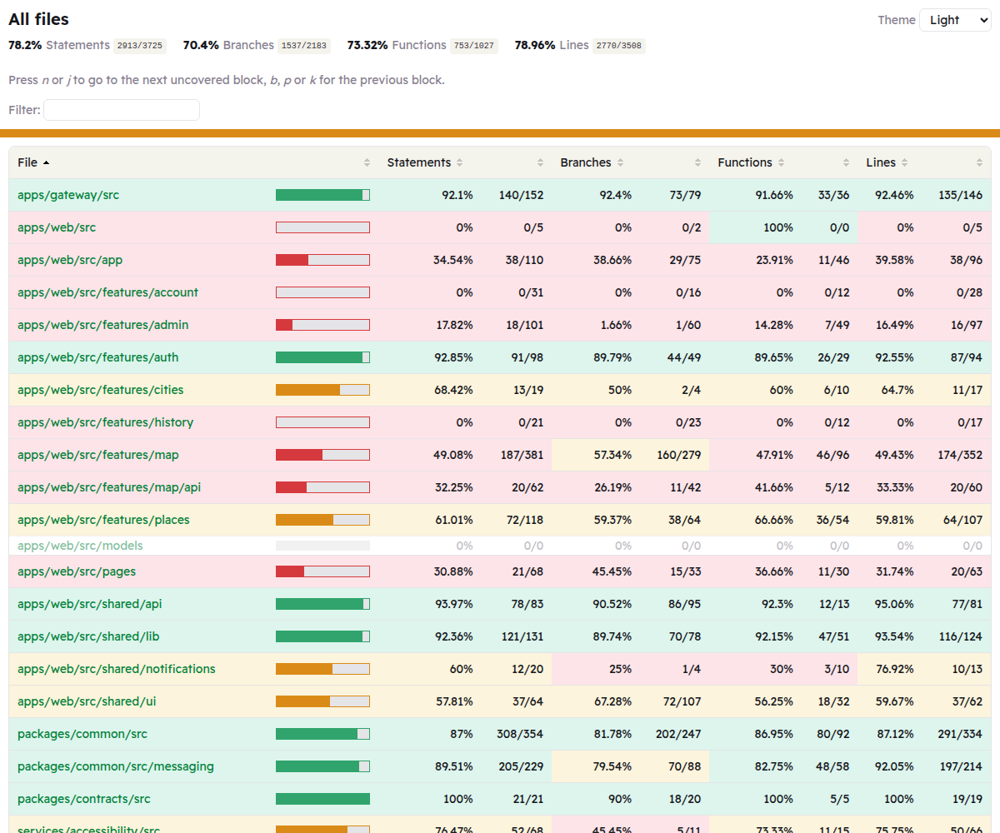
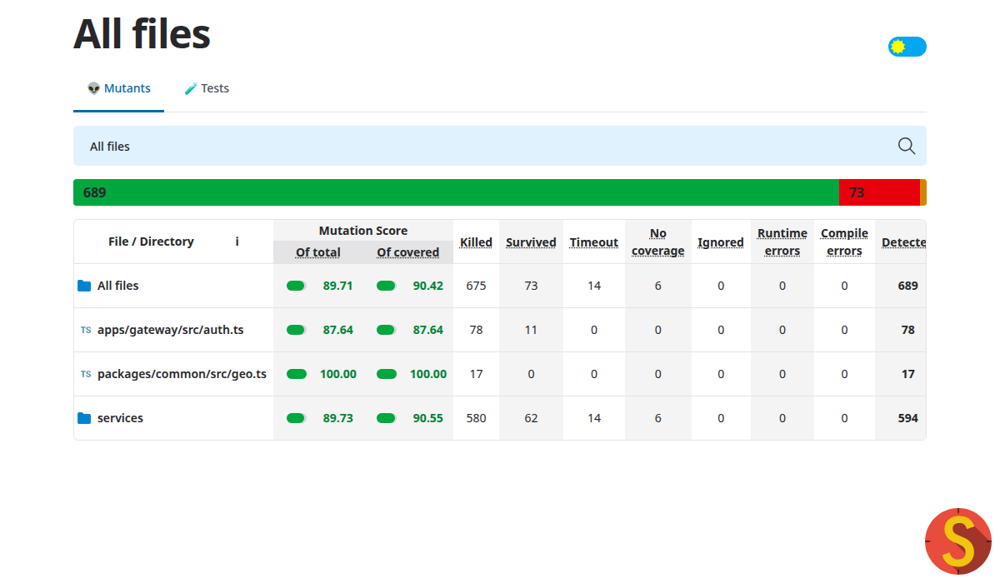

# Evidence: automated tests

Measured on 2026-11-24. Strategy: [specs/testing.md](../../specs/testing.md).

| Check | Result |
| --- | --- |
| `pnpm test:cov` | 417 tests in 75 files passed; thresholds met |
| Coverage, back end | 91.6 % lines, 80.5 % branches, 91.9 % functions |
| Coverage, everything | 79.0 % lines, 70.4 % branches, 73.3 % functions |
| `pnpm test:mutation` | 89.7 % (689 of 768 mutants detected, 79 survived) |
| `pnpm e2e` | 16 passed, 5 of 5 runs, no retries |
| Unit and integration, repeated | 10 of 10 runs green, no retries (254 tests at that time) |

Surviving mutants were reviewed. Tests were added for the meaningful ones (city borders of the
geocoder, password parameters, anchors of patterns, horizon of RAPTOR): 83.1 % → 89.7 %. The rest are
equivalent (for example skipping work that changes nothing) or texts of messages.

A run of GitHub Actions is linked here after the first push: _pending_.
