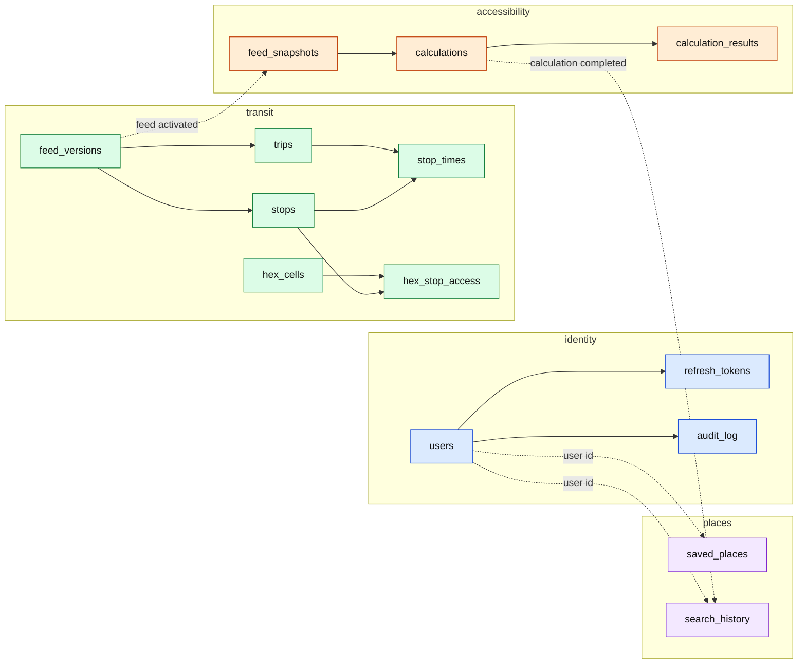

# Database

> [!WARNING]
> **Work in progress.** The project is still being developed: tables, migrations, roles and this
> page may change. The state described here is the current one in this branch.

## Contents

- [At a glance](#at-a-glance)
- [The picture](#the-picture)
- [Documentation](#documentation)
- [Schemas and tables](#schemas-and-tables)
- [Design: 3NF, keys, constraints, types](#design-3nf-keys-constraints-types)
- [Integrity, transactions, data quality](#integrity-transactions-data-quality)
- [Roles and access](#roles-and-access)
- [Passwords and personal data](#passwords-and-personal-data)
- [Data layers](#data-layers)
- [Indexes, views, triggers, procedures](#indexes-views-triggers-procedures)
- [Creating and versioning the structure](#creating-and-versioning-the-structure)
- [Test and reference data](#test-and-reference-data)
- [Why one DBMS](#why-one-dbms)
- [Check it yourself](#check-it-yourself)

The full design is in [docs/03-database.md](../docs/03-database.md); this page is the short
version, ordered like the requirements.

## At a glance

| | |
| --- | --- |
| DBMS | **PostgreSQL 16** with PostGIS (spatial data), `citext`, `btree_gist` |
| Structure | 4 schemas, one per service, **32 tables** + 7 staging tables, 8 views (1 materialized), 80 indexes, 8 triggers, 12 procedures and functions |
| Created by | SQL only: [db/bootstrap/](../db/bootstrap/) (roles, schemas) and versioned migrations in `services/<name>/migrations/`, all in Git |
| Runs as | a separate login role per service (`svc_*`); never as superuser |
| Passwords | Argon2id, enforced by a `CHECK` in the database |
| Personal data | masked views for read-only roles; erasure on account deletion |
| Planned | [Squawk](https://github.com/sbdchd/squawk) in CI: an automatic review of every new migration for operations that lock tables or break running code; the migrations themselves stay plain SQL ([why](#migration-tooling)) |

## The picture

Main tables and relationships, one colour per schema (= per service). Solid arrows are foreign
keys. Dashed lines are references between schemas **without** a foreign key (services never join
across schemas):

- `feed activated` and `calculation completed` are filled by events through RabbitMQ
  (`transit.feed.activated.v1`, `accessibility.calculation.completed.v1`);
- `user id` comes from the sign-in token (the gateway passes it to the service); when an account
  is deleted, the event `identity.user.deleted.v1` makes `places` remove these rows, so no
  reference to a deleted user remains.



Every table and relationship: the [logical schema](../docs/db/img/logical-schema.svg) and one ER
diagram per schema with attributes and keys
([identity](../docs/db/img/er-identity.svg), [transit](../docs/db/img/er-transit.svg),
[accessibility](../docs/db/img/er-accessibility.svg), [places](../docs/db/img/er-places.svg)).

## Documentation

| Requirement | Where |
| --- | --- |
| Data dictionary: layers, tables, columns, types, keys, quality expectations | [docs/db/data-dictionary.md](../docs/db/data-dictionary.md): generated from the database catalog, so it cannot drift; every table, column, constraint, index, trigger, view, routine and privilege, each with a description (`COMMENT ON` in the migrations). Layers and quality: below |
| Integrity and transactions | [below](#integrity-transactions-data-quality); details in [docs/03-database.md](../docs/03-database.md#integrity-and-transactions) |
| ER diagram, logical schema | [docs/db/img/](../docs/db/img/) (SVG and PNG, colour per schema), [the picture](#the-picture) above |
| DDL | [db/bootstrap/001_roles_schemas.sql](../db/bootstrap/001_roles_schemas.sql) and `services/*/migrations/*.sql` |

## Schemas and tables

| Schema (service) | Tables | Holds |
| --- | --- | --- |
| `identity` | 6 | accounts, roles, refresh tokens, audit log, outbox |
| `transit` | 15 | cities, feed sources and versions, the GTFS timetable (agencies, routes, trips, stops, stop times, services, transfers), the hexagon grid and the stops reachable from each cell, outbox |
| `transit_staging` | 7 | GTFS files exactly as published, before checks |
| `accessibility` | 6 | timetable snapshots, calculations (the cache) and their per-cell results, legend classes, outbox, inbox |
| `places` | 5 | saved places and their kinds, search history, geocoder cache, inbox |

## Design: 3NF, keys, constraints, types

- **3NF.** Every table has a primary key; other columns depend on the whole key and nothing else.
  Derived values are not stored: the transit/car ratio and its legend class are computed in a view.
  Lookups with their own attributes are tables (`ratio_classes` has bounds and a colour); closed
  lists without attributes are `CHECK`s. Reasoning: [docs/03-database.md#normalisation-3nf](../docs/03-database.md#normalisation-3nf).
- **Relationship types.** One-to-many (user → refresh tokens), many-to-many through a link table
  (cells ↔ stops via `hex_stop_access`, stop ↔ stop via `transfers`), self-reference
  (`refresh_tokens.replaced_by`), composite identifying keys (all timetable tables hang under
  `feed_versions` with keys `(feed_version_id, id)`), reference lookups.
- **Keys and constraints.** PK and FK on every table; `NOT NULL`, `UNIQUE`, `CHECK` (email format,
  Argon2id prefix, `departure_s >= arrival_s`, statuses), partial unique indexes (one active
  feed per source), an exclusion constraint (legend ranges cannot overlap), domains (`h3_cell`,
  `city_code`, `gtfs_seconds`). All listed per table in the data dictionary.
- **Types.** `uuid` ids for users and calculations, `timestamptz` for every moment, `date` for
  service dates, `integer` seconds for durations, `numeric(5,2)` for ratio bounds, PostGIS
  `geography(Point)` for locations, `citext` for case-insensitive email, `inet` for IP addresses.
- **JSON.** One column only: `outbox.payload`, the body of an outgoing event. Its structure is
  defined and validated per event type in [contracts/asyncapi/](../contracts/asyncapi/), and it is
  never queried by content (justified in [docs/03-database.md](../docs/03-database.md#normalisation-3nf)).

## Integrity, transactions, data quality

- **Transactions.** Every API command is one transaction (`READ COMMITTED`). A change and the
  event about it are written in the same transaction (outbox). The GTFS import goes from staging
  to the typed tables in one procedure call: all or nothing. Row locks (`FOR UPDATE`,
  `SKIP LOCKED`) and an advisory lock guard the few places with concurrent writers.
- **Business rules in the database.** Status machines (a feed version or a calculation can only
  move along allowed transitions), at most 20 saved places per user, history trimmed to 50 rows,
  audit of account changes: all triggers, so no code path can bypass them.
- **Data quality expectations.** Enforced, not just documented: typed columns and checks reject
  bad values; the import's quality gates (`transit.promote_feed`) stop a feed with orphan rows
  (stop times without a trip or stop, trips without a route or service) or no service days;
  a feed with more than 25 % of its stops outside the city is refused. A refused feed leaves the
  live timetable untouched.

## Roles and access

| Role | What it may do |
| --- | --- |
| `app_admin` (admin) | owns the schemas; runs migrations and reference data; not a superuser |
| `svc_identity`, `svc_transit`, `svc_accessibility`, `svc_places` | one per service, each only in its own schema (through the group `identity_rw`, ...) |
| `app_write` (write) | all `*_rw` groups, for operator tools, not for services |
| `app_read` (read), login `reporting` | read-only; personal data only through masked views |

- **No superuser at run time:** each service checks at start-up that its role is not a
  superuser, not `app_admin` and cannot create roles or databases, and refuses to start otherwise.
- **New objects:** grants come from `ALTER DEFAULT PRIVILEGES` set once in the bootstrap; the
  privileges section of the data dictionary is regenerated with every migration and reviewed.
- `PUBLIC` has no rights. Role passwords are set from the environment (SCRAM-SHA-256), never stored in Git.

## Passwords and personal data

- **User passwords:** hashed with **Argon2id** in the application; the column accepts only
  `$argon2id$...` values (`CHECK users_password_algo`), so a plain or MD5/SHA-1 value cannot be
  stored. Refresh tokens are stored as SHA-256 of a random 256-bit value.
- **Masking:** read-only roles see `j***@example.com` and `J***` instead of email and name
  (`identity.v_users_masked`), IPs cut to /24 (`v_audit_masked`), saved places without name or
  address with coordinates rounded to about 1 km (`places.v_saved_places_masked`), history only as
  aggregates (`v_search_stats`). The origin of a map is stored as a hexagon, not as an address.
- **Anonymisation:** deleting an account runs `identity.anonymize_user`, and `places.erase_user`
  then removes the user's places and history.

## Data layers

Used where data arrives from outside in bulk: the GTFS import.

| Layer | Where | Why |
| --- | --- | --- |
| Raw | the original zip in storage + its SHA-256 in `transit.feed_versions` | any version can be re-imported; duplicates detected by hash |
| Staging | `transit_staging.*`: text columns, no constraints | fast `COPY` exactly as published; bad rows stay visible instead of failing the load |
| Core | `transit.*` timetable tables in 3NF | typed, checked; filled only by `transit.promote_feed` |
| Mart | `transit.hex_stop_access`, `transit.mv_city_coverage`, the timetable served to `accessibility` | what consumers need, computed once per feed version |

Accounts, places and calculations are written directly in their final form; a staging layer
there would add nothing.

## Indexes, views, triggers, procedures

- **Indexes** (80, each justified in [docs/03-database.md#indexes](../docs/03-database.md#indexes)):
  GiST for "stops near a cell", BRIN for time ranges in append-only tables, partial indexes for
  "pending events" and "live sessions", composite indexes for the timetable export and the history
  page. [docs/db/query-plans.md](../docs/db/query-plans.md) shows `EXPLAIN (ANALYZE, BUFFERS)` on
  generated volume data (100k users, 1.2M stop times) as proof they are used.
- **Views** (8, one of them materialized): masked views for read-only roles, `transit.v_active_feeds`,
  `accessibility.v_calculation_results` (ratio and class at read time), `v_daily_usage`
  (average and p95 calculation time), and the **materialized** `transit.mv_city_coverage`,
  refreshed when a feed is activated.
- **Procedures and functions** (12, plus 8 trigger functions): `promote_feed`, `activate_feed`, `rebuild_transfers`,
  `rebuild_hex_stop_access` (the import pipeline), `anonymize_user`, `erase_user`,
  `purge_expired`, masking and time helpers.
- **Triggers** (8): status machines of feed versions and calculations, one current snapshot per city, the 20-place limit, history trimming, audit, `updated_at`.

## Creating and versioning the structure

- Nothing is created by hand: `db/bootstrap` once as superuser (roles, schemas, extensions,
  default privileges), then each service's numbered SQL migrations as `app_admin`
  ([node-pg-migrate](https://salsita.github.io/node-pg-migrate/), up and down parts).
- Applied migrations are recorded in `<schema>.pgmigrations`; merged migrations are never edited,
  a change is a new file; history is the Git log.
- CI on every pull request: clean database → migrate up, down, up → reference data →
  [db/tests/smoke.sql](../db/tests/smoke.sql) (constraints, triggers, procedures, masking,
  privileges) → regenerate the data dictionary and fail if it differs from the committed one.
- Backup and restore: [docs/db/operations.md](../docs/db/operations.md).

### Migration tooling

The migrations are plain SQL on purpose (decision D2 in
[docs/02-architecture.md](../docs/02-architecture.md#decisions)): most of what makes this database
interesting (triggers, procedures, domains, an exclusion constraint, masked views, PostGIS types,
one schema and role per service) cannot be described in the model of an ORM. What was considered:

| Tool | Verdict |
| --- | --- |
| Prisma Migrate, Drizzle Kit | rejected: their schema languages cannot express triggers, procedures, domains or masked views, so most migrations would still be raw SQL inside them, plus a second source of truth |
| Atlas (declarative schema, diff, lint) | the strongest "schema as code" option, but views, functions, procedures, triggers, domains and extensions are in the paid Pro plan |
| pgroll (zero-downtime expand/contract) | worth it only with live traffic; every client would have to switch schema versions through `search_path`, which clashes with one role per schema |
| **Squawk** (linter for PostgreSQL migrations, open source) | **planned, not set up yet**: will run in CI on each new `.sql` file and flag operations that lock tables or break running code, e.g. an index created without `CONCURRENTLY`, a dropped or renamed column, a constraint added without `NOT VALID`. It adds a safety review without changing how migrations are written |

## Test and reference data

- **Reference tables** (roles, audit event types, route types, legend classes, place kinds, cities, feed sources):
  idempotent scripts in [db/seed/reference/](../db/seed/reference/).
- **Test data:** [fixtures/gtfs/testville/](../fixtures/gtfs/testville/), a small synthetic
  timetable with hand-checked travel times and edge cases (a trip past midnight, a calendar
  exception, a stop without trips, a station row, a walking transfer, a circular route), loaded
  through staging and the real procedures; plus demo accounts (user, admin, an anonymised one), a
  user at the 20-place limit, fresh and expired calculations covering every legend class
  ([db/seed/test/](../db/seed/test/)).

## Why one DBMS

All primary data is relational and spatial and the volumes are small (a city timetable is a few
million rows), so a second DBMS would add operations without adding value. PostgreSQL covers the
analytical needs with a view and a materialized view. Redis is used by the gateway only for
rate-limit counters, not for data (decision D1 in
[docs/02-architecture.md](../docs/02-architecture.md#decisions)).

## Check it yourself

### 1. Start the project

Needs only Docker. In the repository root (details and troubleshooting in
[specs/microservices.md](microservices.md#a-docker-compose-recommended)):

```bash
docker compose -f compose.setup.yaml run --rm setup   # once: creates .env
docker compose up -d --build --wait                    # first time 5-10 min; ends when everything is healthy
```

The database is created by the one-shot container `db-init`: bootstrap (roles, schemas), every
migration, reference data, the hexagon grid and the test data. See it happen:

```bash
docker compose logs --no-log-prefix db-init
```

```text
bootstrap done for database heatmap
identity: up -> 0001_init, 0002_column_comments, 0003_masking_functions_for_app_read, 0004_outbox_trace_context
transit-data: up -> 0001_init, 0002_column_comments, 0003_outbox_trace_context, 0004_import_statistics
...
seeded identity.sql                          <- reference data
staged stop_times.txt: 77 rows               <- test timetable through the data layers:
feed version 1: promoted                        staging -> core (quality gates) -> active
feed version 1: activated for waw
identity: 4 demo accounts created with SEED_DEMO_PASSWORD
places: 23 saved places, 2 history rows, 2 geocoder entries
database ready
```

### 2. Open a database shell

```bash
docker compose exec postgres psql -U app_admin -d heatmap   # admin role (owns the objects, not a superuser)
docker compose exec postgres psql -U reporting -d heatmap   # read-only role
```

Leave with `\q`. Inside `psql`, the structure:

| Command | Shows |
| --- | --- |
| `\dn` | the schemas: `identity`, `transit`, `transit_staging`, `accessibility`, `places` |
| `\dt places.*` | the tables of one schema |
| `\d+ identity.users` | columns, types, defaults, keys, `CHECK`s, indexes, triggers and comments of a table |
| `\dv *.*`, `\dm transit.*` | views, materialized views |
| `\df transit.*` | procedures and functions |
| `\du` | roles; `\dp identity.*` the privileges on a schema's tables |
| `SELECT name, run_on FROM transit.pgmigrations;` | the migrations applied to a schema |

The same, as a document: [docs/db/data-dictionary.md](../docs/db/data-dictionary.md).

### 3. See the rules work

Each of these fails on purpose, so nothing changes:

```sql
-- as reporting: no access to raw personal data, only to the masked view
SELECT email FROM identity.users;
--   ERROR:  permission denied for table users
SELECT email_masked, display_name_masked FROM identity.v_users_masked;
--   d***@example.com | D***

-- as app_admin: passwords must be Argon2id
SELECT left(password_hash, 30) FROM identity.users LIMIT 1;
--   $argon2id$v=19$m=19456,t=2,p=1
INSERT INTO identity.users (email, password_hash) VALUES ('x@example.com', 'plain');
--   ERROR:  ... violates check constraint "users_password_algo"

-- trigger: at most 20 saved places (the test user full.places@example.com has 20)
INSERT INTO places.saved_places (user_id, kind_id, label, address_text, city_code, geom)
SELECT user_id, 4, 'One more', 'Somewhere 1', 'waw', ST_SetSRID(ST_MakePoint(21.0, 52.2), 4326)::geography
FROM places.saved_places GROUP BY user_id HAVING count(*) = 20;
--   ERROR:  user ... already has 20 saved places

-- trigger: a feed version moves only along allowed statuses
UPDATE transit.feed_versions SET status = 'downloaded' WHERE status = 'active';
--   ERROR:  feed version 1: illegal status change active -> downloaded

-- exclusion constraint: legend ranges cannot overlap
INSERT INTO accessibility.ratio_classes (class_id, code, label, min_ratio, max_ratio, color, sort_order)
VALUES (99, 'overlap', 'Overlap', 1.0, 1.5, '#000000', 99);
--   ERROR:  conflicting key value violates exclusion constraint "ratio_classes_no_overlap"
```

And the views at work:

```sql
SELECT city_code, hex_total, hex_with_stop, stops, trips FROM transit.mv_city_coverage;   -- materialized
SELECT h3_index, transit_s, car_s, ratio, class_code FROM accessibility.v_calculation_results LIMIT 5;
SELECT * FROM places.v_saved_places_masked LIMIT 5;   -- no names or addresses, coordinates rounded
```

### 4. Development tools (Node.js and pnpm)

`pnpm db:smoke` runs the full SQL smoke test ([db/tests/smoke.sql](../db/tests/smoke.sql)),
`pnpm db:dict` regenerates the data dictionary, `pnpm db:plans` the query plans,
`pnpm db:diagrams` the diagrams (setup in the [README](../README.md#quick-start-development)).
