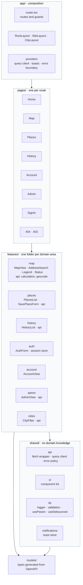
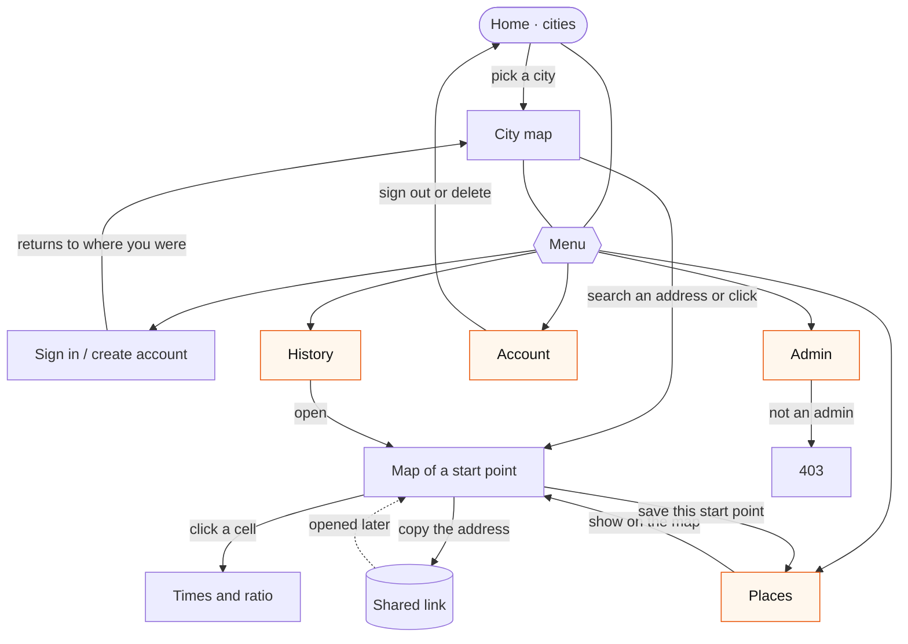

# Front-end

> [!WARNING]
> **Work in progress.** The project is still being developed: pages, components and this document
> may change. The state described here is the current one in this branch.

## Contents

- [At a glance](#at-a-glance)
- [Architecture diagram](#architecture-diagram)
- [Architecture approach](#architecture-approach)
- [Modules and loading](#modules-and-loading)
- [Performance](#performance)
- [Routes](#routes)
- [State management](#state-management)
- [User flows and navigation](#user-flows-and-navigation)
- [API used by the client](#api-used-by-the-client)
- [Errors, loading and logging](#errors-loading-and-logging)
- [Forms and lists](#forms-and-lists)
- [Components and styles](#components-and-styles)
- [Tests](#tests)
- [Tech stack and why](#tech-stack-and-why)
- [How to run](#how-to-run)

## At a glance

| | |
| --- | --- |
| What | A single-page application: pick a city, pick a start address, see the city coloured by how much slower public transport is than a car; accounts, saved places, history, administration |
| Code | [apps/web/](../apps/web/) |
| Framework | React 19 with TypeScript (strict, no `any`), built by Vite |
| Routing | React Router: a home page, one route per city (`/cities/:code`, built from the API), places, history, account, admin, sign-in, 404 |
| State | Server state in TanStack Query, client global state in Zustand, view settings in the URL, the rest local |
| UI | Own component kit (`shared/ui`) on design tokens; MapLibre GL for the map |
| API | The gateway's REST API; types generated from the OpenAPI contracts |
| Tests | 25 unit and component test files (Vitest, Testing Library in jsdom), Playwright end-to-end tests |

## Architecture diagram

Layers from top to bottom; an arrow means "uses". A layer never imports from a layer above it,
a feature is used from outside only through its public entry, and only `shared/api` and the
`api` modules of the features call the server; ESLint enforces all three
([Modules and loading](#modules-and-loading)).



Folder layout of [apps/web/src/](../apps/web/src/):

```text
app/          router, layouts (root, site, city), providers, guards, error boundaries
pages/        one component per route; composes features, no requests of its own
features/     map, places, history, auth, account, admin, cities: components + api hooks;
              each with a public entry index.ts
shared/api/   fetch wrapper (client.ts), query client, global error policy
shared/ui/    component kit (Button, TextField, Select, Card, Table, Dialog, Toast, ...)
shared/lib/   logger, validation rules, URL-backed settings, debounce, safe redirect
shared/test/  helpers for component tests (imported by tests only)
models/       API types (from @heatmap/contracts, generated from contracts/openapi)
styles/       design tokens, base styles, layout and feature styles
```

## Architecture approach

- **Component-based, organised by feature.** Each domain area (map, places, history, auth,
  account, admin, cities) keeps its components and its data access together. Pages only compose
  features; `shared` holds what has no domain knowledge. This is close to Feature-Sliced Design
  (app → pages → features → shared), without its full ceremony.
- **Container and presentational parts.** Pages and `api` hooks own data and side effects;
  components below them receive data and callbacks (for example `PlacesList` gets the places
  and an `onShow` callback; `MapView` gets cells and a legend).
- **Server state is not copied into client state.** Data from the API lives in the TanStack
  Query cache and is read through hooks; there is no store that mirrors it. This removes most of
  what Flux/Redux would be used for.
- **Small global client state.** Only what is truly global and not from the server (the signed-in
  session, the toasts) is in Zustand stores.
- **The URL is state too.** The city, the start point, the departure, list filters and sort
  orders live in the address, so every view can be shared, reloaded and navigated with
  back/forward.
- **Contracts first.** Request and response types come from the OpenAPI files of the services;
  a change of the API shows up as a type error in the client.
- **No micro frontends.** One team, one deployable page; a split would add build and runtime
  complexity without a benefit here.

## Modules and loading

**Feature modules.** Every folder in `features/` is a module with one public entry,
`features/<name>/index.ts`, that lists what other code may use (for example `features/places`
offers `usePlaces`, `PlacesList`, `SavePlaceForm` and the `SavedPlace` type; its sorting, rules
and query keys stay inside). Files inside a module import each other freely; everything outside,
including other features, goes through the entry. Tests sit with the module they test.

**Enforced by ESLint.** A local rule, [apps/web/eslint/boundaries.js](../apps/web/eslint/boundaries.js)
(`web/boundaries`), resolves every relative import (static, re-export and dynamic `import()`)
against the importing file and reports:

| Mistake | Example |
| --- | --- |
| an import from a higher layer | a page importing from `app/`, `shared/` importing a feature |
| a page importing another page | `HistoryPage` importing from `PlacesPage` |
| a feature used past its public entry | `import … from '../features/places/api.ts'` in a page |

The rule has its own test, [apps/web/test/boundaries.test.ts](../apps/web/test/boundaries.test.ts).
A second rule keeps server calls in the `api` modules (`no-restricted-imports`).

**Lazy routes.** [app/router.tsx](../apps/web/src/app/router.tsx) loads every page except the home
and not-found pages with `React.lazy`; each is wrapped in `Suspense` with a skeleton, inside the
layout, so the menu stays while a page loads. The map engine is split once more: the map
feature's entry exports `MapView` as a lazy component, so importing anything else from the
feature (such as `toSearch` on the places page) never loads MapLibre, and the city layout shows
"Loading the map…" while it arrives.

Chunks of the production build (`pnpm web:build`, gzip; the full table and a treemap are in the
[performance evidence](../docs/evidence/frontend-performance.md#bundle-analysis)):

| Chunk | Loaded | Size |
| --- | --- | --- |
| `index` (React DOM, query, layouts, home page) + `ui` (router, kit) + `logger` | at start | 85 + 35 + 4 kB |
| `MapPage` · `SignInPage` · `PlacesPage` · `HistoryPage` · `AccountPage` · `AdminPage` | with their route | 1 · 0.4 · 0.3 · 1.3 · 1.1 · 4 kB |
| `MapView` (MapLibre GL) | with the first city map | 297 kB |
| `hexagons.worker` (H3), `maplibre-gl-worker` | in workers on the map page | 206, 520 kB raw |

## Performance

Details and measurements: [docs/evidence/frontend-performance.md](../docs/evidence/frontend-performance.md).

- **Code splitting:** lazy pages and a lazy map engine (above); h3-js is not in the start chunk.
  The first visit of `/`, `/sign-in` or `/places` loads about 125 kB of JavaScript (gzip), none of
  it MapLibre (checked by an end-to-end test).
- **Web Worker:** the polygons of the cells and their merging when zoomed out are prepared in
  [hexagons.worker.ts](../apps/web/src/features/map/hexagons.worker.ts) by
  [useHexagons](../apps/web/src/features/map/useHexagons.ts): one worker per map, results kept per
  resolution, stale answers dropped, main-thread fallback where workers are missing or fail. With
  5 333 cells and a four times slower CPU the median blocking time while a map is drawn drops
  from 380 to 161 ms, and from 73 to 9 ms when zooming out.
- **Memoisation:** `MapView` and `Legend` are memoised and the map gets a stable callback, so the
  map does not re-render with every change of the panel. Small lists are not memoised.
- **Lighthouse** (`scripts/lighthouse.sh`): home and sign-in 99–100 on desktop and mobile, the
  map 99 on desktop; the map on mobile scores 68, a justified exception (the 297 kB engine and
  the requests the map needs on simulated slow 4G).
- **Bundle report:** `pnpm web:analyze` writes a treemap to `apps/web/dist/stats.html`.

## Routes

[app/router.tsx](../apps/web/src/app/router.tsx); every route has an error boundary
(`errorElement`).

| Route | Page | Access | Layout |
| --- | --- | --- | --- |
| `/` | Home: the cities of this instance, search | everyone | site (menu on top) |
| `/cities/:code` | Map of one city; `?lat=&lon=&date=&time=` holds a shared map | everyone | city (panel + map) |
| `/sign-in` | Sign in or create an account; `?next=` where to return | everyone | site |
| `/places` | Saved places, filter by city, sort | signed in | site |
| `/history` | Maps looked at before, filter by city | signed in | site |
| `/account` | Profile, sign out, delete the account | signed in | site |
| `/admin` | Coverage, feed import, versions, activation | admins (others: 403 page) | site |
| `*` | 404 page | everyone | site |

Every page except home and 404 is loaded on first visit ([Modules and loading](#modules-and-loading)).
Guards ([app/guards.tsx](../apps/web/src/app/guards.tsx)): while the session is being restored
they show a skeleton; a signed-out visitor is sent to `/sign-in?next=<where they were>`; a user
who signs out on a protected page goes to the home page; a non-admin on `/admin` sees the 403
page. Cities are not hard-coded: `/cities/:code` accepts whatever `GET /cities` returns, and an
unknown code shows "City not found".

## State management

| Kind | Where | Holds |
| --- | --- | --- |
| Server state | TanStack Query cache ([shared/api/queryClient.ts](../apps/web/src/shared/api/queryClient.ts)) | cities, legend, saved places, history (paged), admin versions (polled during an import) and coverage, address suggestions |
| Global client state | Zustand: session ([features/auth/session.ts](../apps/web/src/features/auth/session.ts)), notifications ([shared/notifications/store.ts](../apps/web/src/shared/notifications/store.ts)) | who is signed in and why a session ended; the toasts |
| URL | React Router search params, [shared/lib/useParam.ts](../apps/web/src/shared/lib/useParam.ts) | city, start point, departure; list filters and sort orders (remembered for the tab) |
| Loaded reference data | React context ([features/cities/data.ts](../apps/web/src/features/cities/data.ts)), provided by the root layout | the cities and the legend, once loaded (`useCityData`) |
| Map state | React context per city ([features/map/MapState.tsx](../apps/web/src/features/map/MapState.tsx)) | the current start point, departure and calculation of the open city |
| Local state | `useState` in components | form fields and their errors, open dialogs, editing mode |

Query keys: `['cities']`, `['legend']`, `['geocode', city, text]`, `['coverage', city]`, and
under `['me', …]` everything that belongs to the signed-in user (`places`, `history`,
`admin`), dropped from the cache in one call when the session ends. Mutations update the cache
from the server's answer (a saved place appears on the city page and on the places page at
once); an activation refreshes versions, coverage and the cities.

**Why not Redux.** Almost all shared state comes from the server, and TanStack Query already
gives caching, de-duplication, retries, polling, pagination and loading/error flags per query.
What is left global (session, toasts) is two small stores; Zustand gives them selectors and
subscriptions without reducers, actions and boilerplate.

**The session.** The access token is kept in memory only; the refresh token is an httpOnly
cookie the page never sees. Refreshing runs one at a time in a tab and across tabs (Web Lock),
because the server revokes every session when a rotated refresh token is reused. Details:
[docs/02-architecture.md#sessions-in-the-browser-web](../docs/02-architecture.md#sessions-in-the-browser-web).

## User flows and navigation



Orange pages need a signed-in user; without one the guard opens sign-in and returns afterwards.

Main flows:

1. **Look at a map (anonymous).** Home → a city → type an address and pick a suggestion (or click
   the map) → the cells appear; zoom out merges them; a click on a cell shows both times and the
   ratio; the address bar now holds a link to this map.
2. **Save a place.** Sign in (from the menu; the page returns to the city) → "Save this start
   point" → kind and name → it appears as a quick pick in the city and on the places page.
3. **Come back later.** Places → a place opens its city with that start point; History → an
   earlier map opens from the cache (or is computed again if it expired).
4. **Leave.** Account → delete → confirmation → the session ends and the data is erased in every
   service.
5. **Administer.** Admin → import a feed by its source code → the list follows the import →
   activate a validated version (confirmation dialog).

## API used by the client

All calls go to the gateway under `/api/v1` through one wrapper,
[shared/api/client.ts](../apps/web/src/shared/api/client.ts): it adds `X-Correlation-Id` and
the access token, parses JSON, turns problem responses into `ApiError` (status, problem type,
field errors, `Retry-After`, correlation id) and, on a 401 with a token, refreshes the session
once and retries. Types come from [models/types.ts](../apps/web/src/models/types.ts), generated
from [contracts/openapi/gateway.yaml](../contracts/openapi/gateway.yaml); every endpoint is
described in [docs/04-contracts.md](../docs/04-contracts.md).

| Method and path | Used by | Request → response |
| --- | --- | --- |
| GET `/cities` | `useCitiesQuery` | → `{ items: City[] }` |
| GET `/legend` | `useLegendQuery` | → `{ items: LegendClass[] }` |
| GET `/geocode?city=&q=` | `useGeocode` | → `{ items: GeocodeCandidate[] }` (up to 5) |
| POST `/calculations` | `runCalculation` | `CalculationRequest` → `Calculation` (`201` computed, `200` cached, `202` running) |
| GET `/calculations/{id}` | `runCalculation`, `loadCalculation` (polling) | → `Calculation` |
| GET `/calculations/{id}/results` | `runCalculation`, `loadCalculation` | → `CalculationResults` |
| POST `/auth/register`, `/auth/login`, `/auth/refresh`, `/auth/logout` | session | `{ email, password, displayName? }` → `TokenResponse` (refresh token as cookie) |
| GET, PATCH, DELETE `/users/me` | session, account | → `UserProfile`; `{ displayName }` → `UserProfile`; → `204` |
| GET, POST `/places`; PATCH, DELETE `/places/{id}` | `usePlaces` | → `{ items: SavedPlace[] }`; `CreatePlaceRequest` → `SavedPlace`; `UpdatePlaceRequest` → `SavedPlace`; → `204` |
| GET `/history?limit=&cursor=` | `useHistory` (infinite) | → `{ items: HistoryEntry[], nextCursor }` |
| GET `/admin/feed-versions?status=&source=` | `useFeedVersions` | → `{ items: FeedVersion[] }` |
| POST `/admin/feed-sources/{code}/import` | `useImportFeed` | → `ImportAccepted` |
| POST `/admin/feed-versions/{id}/activate` | `useActivateVersion` | → `FeedVersion` |
| GET `/cities/{code}/coverage` | `useCoverage` | → `CityCoverage` (`404` without a timetable) |

Examples (bodies shortened):

```http
POST /api/v1/calculations
{ "cityCode": "waw", "origin": { "lat": 52.2002, "lon": 21.0302 }, "windowMinutes": 0 }

201 Created
{ "calculationId": "c0f3…", "status": "done", "cityCode": "waw", "originH3": "8a1f5226d2f7fff",
  "date": "2026-11-24", "time": "08:00", "cellCount": 5333, "durationMs": 640, … }
```

```http
GET /api/v1/calculations/c0f3…/results

200 OK
{ "calculationId": "c0f3…", "resolution": 9,
  "cells": [ { "h3": "891f5226d2fffff", "transitS": 1320, "carS": 780, "ratio": 1.69, "class": "fair" } ] }
```

```http
POST /api/v1/places
{ "kind": "home", "label": "Home", "addressText": "Alpha Square 1, Testville",
  "cityCode": "waw", "location": { "lat": 52.2001, "lon": 21.0003 } }

409 Conflict  (application/problem+json)
{ "type": "/problems/duplicate-label", "title": "Conflict", "status": 409,
  "detail": "A saved place with this label already exists.", "correlationId": "…" }
```

## Errors, loading and logging

- **Error boundaries.** `RouteError` is the router's `errorElement` (a failed page keeps the
  menu); `AppErrorBoundary` wraps the whole application. Both show what to do and a reference
  instead of a blank page ([app/ErrorBoundary.tsx](../apps/web/src/app/ErrorBoundary.tsx)).
- **Where an error is shown** ([shared/api/errorPolicy.ts](../apps/web/src/shared/api/errorPolicy.ts)):

  | Error | Shown as |
  | --- | --- |
  | 400 with field errors, 409 duplicate name | message at the field |
  | 400, 404, 409, 422 otherwise | message in the form or view |
  | 401 | the session refreshes once and retries; if the server ended the session: toast "sign in again" |
  | 403 | 403 page for `/admin`; toast for an API call |
  | 404 route, unknown city | 404 page, "City not found" |
  | 429 | toast with the wait time |
  | 5xx, no connection | toast with the reference (the request's correlation id, also in the server logs) |

- **Loading.** Skeletons for every load (root data, session check, lists, admin); a spinner with
  elapsed seconds while a map is computed; buttons show a spinner and block repeated clicks.
- **Logging.** [shared/lib/logger.ts](../apps/web/src/shared/lib/logger.ts): levels (all in
  development, warnings and errors in a production build); every failed request is logged with
  method, path, status and correlation id; render errors with their reference.

## Forms and lists

- **Forms** are controlled components with field rules
  ([shared/lib/validation.ts](../apps/web/src/shared/lib/validation.ts) plus a rules module next
  to each form): sign-in and registration, save and rename a place, profile name, feed import.
  Invalid input is not sent; the message appears under the field and the field is marked
  `aria-invalid`; after the first attempt fields are checked while typing.
- **Lists and tables:** saved places, history (paged), feed versions, coverage table.
- **Search, filter, sort:** address search, city search on the home page; filter by city
  (places, history), by status and source (versions); sort places by newest, name or city and
  versions by newest, oldest or status. Settings stay in the URL and survive navigation and
  reloads.

## Components and styles

- **Own component kit** in [shared/ui/](../apps/web/src/shared/ui/): Button and ButtonLink,
  TextField, Select, Checkbox, Card, Badge, Tabs, Table, Skeleton, Toast/Toaster, Dialog. Every
  screen is built from it; no external UI library.
- **Layout components:** `SiteLayout` (menu + page) and `CityLayout` (panel + map) in
  [app/](../apps/web/src/app/).
- **CSS architecture:** design tokens (colours, spacing, radii, type, elevation) as CSS variables
  in [styles/tokens.css](../apps/web/src/styles/tokens.css); base styles in `styles/base.css`;
  each kit component has its own CSS file with `ui-` prefixed classes; layouts and feature
  styles in `styles/index.css`. Responsive: below 768 px the city view stacks the map over the
  panel and the menus wrap.
- **Inline styles, the justified exceptions:** the colour swatches of the legend (map legend and
  home page) take their colour from the API (`GET /legend`), so a fixed class cannot describe
  them; the map's cursor is set through MapLibre's API on its canvas. Nothing else uses inline
  styles.
- **Accessibility basics:** labels tied to every field, errors announced, `aria-current` in the
  menu, keyboard tabs, native modal dialogs, a live region for toasts, reduced motion honoured.

## Tests

| Kind | What | Where |
| --- | --- | --- |
| Unit | ESLint boundary rule, hexagon worker hook (cache, stale answers, fallback), API client and polling, session (refresh once, no overlapping refreshes), hexagon merging and legend classes, URL state, validation rules, sorting, error policy and query cache, logger | `*.test.ts` next to the code |
| Component (Testing Library, jsdom) | sign-in/registration form, places list (sort, filter, delete dialog, rename conflict), route guards (session check, sign-in and return, 403, 404), home page, error boundaries | `*.test.tsx`; helpers in [shared/test/render.tsx](../apps/web/src/shared/test/render.tsx) |
| End to end (Playwright) | map, account, admin, routes and navigation, performance (main-thread blocking with and without the worker; no map engine on sign-in and places) against the full stack | [tests/e2e/](../tests/e2e/) |

`pnpm test` runs unit and component tests; `pnpm e2e:up && pnpm e2e` the end-to-end suite.

## Tech stack and why

| Choice | Why | Considered |
| --- | --- | --- |
| **React 19** | Component model fits a map page with many independent panels; the largest ecosystem for maps (MapLibre bindings, h3), testing and hiring; the team knows it | Vue 3, Angular (more structure built in, but heavier for one map-centred page) |
| **TypeScript, strict** | Types generated from the OpenAPI contracts catch API changes at build time | — |
| **Vite** | Fast dev server with module reload, simple proxy to the gateway, production build with code splitting | Webpack, Create React App (deprecated) |
| **React Router** | The standard router for React; nested routes give the two layouts and per-route error boundaries | TanStack Router |
| **TanStack Query** | Server state is most of the state: caching, de-duplication, retries, polling, infinite lists and loading/error flags without hand-written reducers | Redux Toolkit Query, SWR |
| **Zustand** | The little global client state (session, toasts) as small stores with selectors; usable outside React (the session refresh) | Redux Toolkit (too much ceremony for two stores), React context |
| **Own component kit** | A small, consistent set that matches the map design and keeps the bundle small; full control over accessibility | Material UI, Ant Design (large, a look of their own) |
| **MapLibre GL + OpenFreeMap** | Open-source vector maps, free tiles without a key, WebGL performance for thousands of hexagons | Leaflet (raster, slower with many polygons), Mapbox (paid key) |
| **h3-js** | The same H3 grid as the server; hexagons built and merged in the browser | — |
| **Vitest, Testing Library, Playwright** | Same test runner as the services; tests through what the user sees; real browser for end-to-end | Jest, Cypress |
| **ESLint, Prettier** | One style; react-hooks rules; a rule that keeps server calls in the api layer | — |

## How to run

- **Everything in Docker** (the built page on <http://localhost:8000>):
  [specs/microservices.md](microservices.md#a-docker-compose-recommended).
- **Development with live reload** (needs Node.js and pnpm): start the stack as above, then
  `GATEWAY_URL=http://localhost:8000 pnpm web:dev` and open <http://localhost:5173>; the dev
  server proxies `/api` to the gateway.
- `pnpm web:build` writes the production build to `apps/web/dist`.
