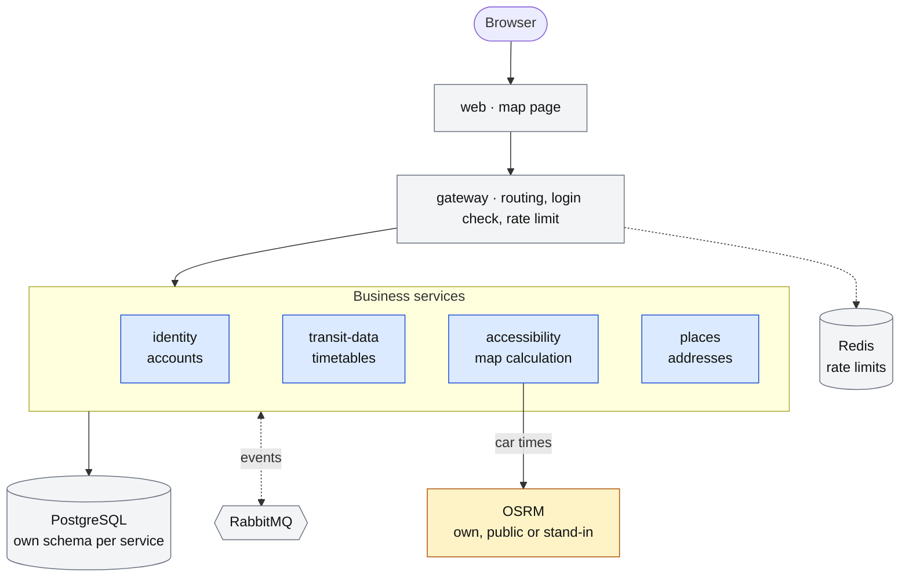

# Microservices

> [!WARNING]
> **Work in progress.** The project is still being developed: services, commands, configuration
> and this page may change. The state described here is the current one in this branch.

## Contents

- [The picture](#the-picture)
- [Business services](#business-services)
- [Supporting components](#supporting-components)
  - [Database: PostgreSQL 16 + PostGIS](#database-postgresql-16--postgis)
  - [Message broker: RabbitMQ](#message-broker-rabbitmq)
  - [Redis](#redis)
  - [Jaeger, OSRM, geocoder](#jaeger-osrm-geocoder)
- [How to run](#how-to-run)
  - [A. Docker Compose (recommended)](#a-docker-compose-recommended)
  - [B. Services on the host (local development)](#b-services-on-the-host-local-development)
  - [C. Terraform on a VPS (production)](#c-terraform-on-a-vps-production)
  - [D. (Optional) A VPS by hand](#d-optional-a-vps-by-hand)
  - [E. (Optional) End-to-end tests](#e-optional-end-to-end-tests)
  - [Car routing (OSRM)](#car-routing-osrm)
  - [Geocoder](#geocoder)
- [Further reading](#further-reading)

A short report on how the Transit Accessibility Heatmap is split into services, what each part
does, where it lives in the repository and how to run it. The full design (sequence diagrams,
gateway rules, resilience patterns, decisions) is in
[docs/02-architecture.md](../docs/02-architecture.md); the requirement-by-requirement evidence is in
[docs/07-requirements-matrix.md](../docs/07-requirements-matrix.md).

**What the product does.** For an address in a city it colours the city, hexagon by hexagon, by
how much slower public transport is than a car (`t_transit / t_car`). It works for any city whose
transport operator publishes its timetable in the open
[GTFS](https://en.wikipedia.org/wiki/GTFS) format; Warsaw and Vilnius are the two cities
configured today (a city needs its boundary, a feed source and, for real car times, OSRM data).

## The picture



Blue boxes are the four business services. Every request from the browser passes through the
gateway. Each service keeps its data in its own schema and never reads another service's tables;
when one service needs something from another it asks over HTTP (accessibility asks transit-data
for timetables, places asks it for the city list) or reacts to an event through RabbitMQ (see
[the three events](#message-broker-rabbitmq)). The yellow box is outside the project: accessibility
asks an OSRM server for driving times (see [Car routing](#car-routing-osrm)). Not shown for
readability: Jaeger (traces) and the geocoder; they are in the
[detailed diagram](../docs/02-architecture.md#container-diagram).

## Business services

All four are TypeScript on Node.js 24 with Fastify, pino logs and OpenTelemetry tracing, built on
the shared platform package [packages/common/](../packages/common/).

| Service | What it does | Stack and data | Code |
| --- | --- | --- | --- |
| **identity** | Registers users, issues sign-in tokens and deletes an account together with its personal data. | PostgreSQL schema `identity`; Argon2id password hashes, EdDSA JWT (`jose`); publishes `identity.user.deleted.v1` | [services/identity/](../services/identity/) |
| **transit-data** | Imports public transport timetables (GTFS), validates them, splits the city into hexagons and serves timetables to other services. | PostgreSQL + PostGIS schemas `transit`, `transit_staging`; `h3-js` grid; publishes `transit.feed.activated.v1` | [services/transit-data/](../services/transit-data/) |
| **accessibility** | For a chosen address computes the travel time by public transport and by car to every hexagon of the city and keeps finished maps in a cache. | PostgreSQL schema `accessibility`; RAPTOR in TypeScript, OSRM for car times, `cockatiel` for resilience; publishes `accessibility.calculation.completed.v1` | [services/accessibility/](../services/accessibility/) |
| **places** | Finds addresses by text, stores the user's saved places and the history of their maps. | PostgreSQL + PostGIS schema `places`; Photon or Nominatim geocoder with a cache; consumes the two events above | [services/places/](../services/places/) |

Why this split (and not another) is argued in
[docs/02-architecture.md#why-this-split](../docs/02-architecture.md#why-this-split): the parts
change at different rates, have different loads (a heavy monthly import, CPU-bound calculations,
small CRUD) and own data of different sensitivity (public timetables versus personal accounts).

## Supporting components

| Component | Role | Stack | Code |
| --- | --- | --- | --- |
| **gateway** | The only entry point: routes each request to its service, checks the login token and the user's role, limits the request rate. | Fastify + `undici` proxy; route table generated from the OpenAPI files; Redis counters | [apps/gateway/](../apps/gateway/) |
| **web** | The map page the user works with (search, heatmap, saved places, history, admin). | React 19, Vite, MapLibre GL, `h3-js`; served by Caddy in containers | [apps/web/](../apps/web/) |

### Database: PostgreSQL 16 + PostGIS

One PostgreSQL server, but each service has **its own schema and its own login role**
(`svc_identity`, `svc_transit`, `svc_accessibility`, `svc_places`) and can only reach its own
tables: no cross-schema queries, joins or foreign keys. PostGIS stores the spatial data (stops,
hexagon centres, addresses). Business rules are enforced by constraints, triggers and
procedures; personal data is masked for read-only roles. Migrations run as `app_admin`; the
superuser is used only for the one-time bootstrap, never by a running service.
Roles and schemas: [db/bootstrap/](../db/bootstrap/); migrations: `services/<name>/migrations/`;
data dictionary and ER diagrams: [docs/db/](../docs/db/); design: [docs/03-database.md](../docs/03-database.md);
the database in one page: [specs/database.md](database.md).

### Message broker: RabbitMQ

Carries events between services where nobody needs to wait for an answer. There are three:

| Event | From | To | Effect |
| --- | --- | --- | --- |
| `transit.feed.activated.v1` | transit-data | accessibility | loads the new timetable into memory |
| `accessibility.calculation.completed.v1` | accessibility | places | adds the map to the signed-in user's history |
| `identity.user.deleted.v1` | identity | places | erases the user's saved places and history |

Reliability: the event is written in the same database transaction as the change (transactional
outbox), so it cannot be lost; a redelivered message is recognised and skipped (inbox table); a
failing message is retried up to 5 times and then moved to the dead-letter queue `heatmap.dlq`.
Every message carries the correlation id and the trace context.
Contract: [contracts/asyncapi/heatmap-events.yaml](../contracts/asyncapi/heatmap-events.yaml);
code: [packages/common/src/messaging/](../packages/common/src/messaging/).

### Redis

Used only by the gateway, for rate limiting: one counter per route and caller (user id when
signed in, otherwise the client IP) in a time window; the limits come from the OpenAPI files.
Over the limit the client gets `429` with `Retry-After`. Redis holds no business data and
nothing on disk; if it is down, requests pass and a warning is logged, so it cannot stop the
service. Code: [apps/gateway/src/rate-limit.ts](../apps/gateway/src/rate-limit.ts).

### Jaeger, OSRM, geocoder

Jaeger collects the traces (OpenTelemetry, OTLP). OSRM computes driving times, one server per
city: your own, the public demo server or a built-in stand-in (see
[Car routing](#car-routing-osrm)). The geocoder (Photon) turns text into coordinates. Out of the
box the Docker setup uses stand-ins for both, so the project runs without road data or internet
access.

## How to run

| Option | For | |
| --- | --- | --- |
| [A. Docker Compose](#a-docker-compose-recommended) | trying and checking everything locally, Docker only | **recommended locally** |
| [B. Services on the host](#b-services-on-the-host-local-development) | working on one service with hot reload | |
| [C. Terraform on a VPS](#c-terraform-on-a-vps-production) | a public server | **recommended for production** |
| [D. A VPS by hand](#d-optional-a-vps-by-hand) | the same as C without Terraform | optional |
| [E. End-to-end tests](#e-optional-end-to-end-tests) | checking a change across all services | optional |
| [Car routing (OSRM)](#car-routing-osrm) | real driving times: public OSRM or your own | optional, any of A–D |

### A. Docker Compose (recommended)

Needs **only Docker** (Docker Desktop on Windows or macOS, Docker Engine with Compose on Linux) and
a copy of the repository; no Node.js, no other tools. The same two commands on every platform, run
in the repository root:

```bash
docker compose -f compose.setup.yaml run --rm setup   # once: creates .env (random passwords, token-signing key)
docker compose up -d --build --wait                    # builds the images (first time 5-10 min), starts, waits until healthy
```

The first command prints the addresses below; the second lists every container as it becomes
healthy and returns only when the whole stack works (or names the container that did not start).

| What | Where |
| --- | --- |
| The map | <http://localhost:8000>: the home page lists the cities; open **Warsaw** (<http://localhost:8000/cities/waw>, the small synthetic timetable "testville"), type `Central Station`, pick the suggestion |
| Health of the gateway and every service | <http://localhost:8000/health> (JSON: Redis and each service `ok` or not) |
| Containers and their state | `docker compose ps` |
| Logs of a service (JSON, with `correlation_id`) | `docker compose logs -f accessibility` |
| Traces | Jaeger UI <http://localhost:16686> |
| Message broker: exchanges, queues, dead-letter queue | RabbitMQ UI <http://localhost:15672>, user `heatmap`, password `RABBITMQ_PASSWORD` from `.env` |
| Database as the read-only role (masked personal data) | `docker compose exec postgres psql -U reporting -d heatmap` |
| Demo accounts | `demo.user@example.com`, `demo.admin@example.com` (Admin tab), password `SEED_DEMO_PASSWORD` from `.env` |
| Stop, or stop and delete all data | `docker compose down`, `docker compose down -v` |

- `.env` stays on the machine (git-ignored). If it already exists, the setup command only adds
  what is missing and never changes a value.
- Only these pages are published; PostgreSQL, RabbitMQ (AMQP) and Redis stay inside Docker, so an
  installed PostgreSQL or Redis does not get in the way. Other host ports: `WEB_PORT`,
  `JAEGER_UI_PORT`, `RABBITMQ_UI_PORT` in `.env`.
- Car times and address search come from two small stand-ins (no road data, no internet needed);
  see [Car routing](#car-routing-osrm) and [Geocoder](#geocoder) to use real ones.
- Under the hood: [compose.yaml](../compose.yaml) includes
  [infra/compose/docker-compose.yml](../infra/compose/docker-compose.yml) (profile `full`, chosen by
  `COMPOSE_PROFILES` in `.env`) with [infra/compose/local.yml](../infra/compose/local.yml).
  Developers with Node.js can use `pnpm full:up` instead.

### B. Services on the host (local development)

Databases and broker in Docker, services with hot reload on the host: see the
[README quick start](../README.md#quick-start-development) (`pnpm infra:up`, `pnpm db:*`, then
`pnpm --filter @heatmap/<service> dev` and `pnpm web:dev`).

### C. Terraform on a VPS (production)

[infra/terraform/vps/](../infra/terraform/vps/) deploys the stack to **an existing VPS** from any
provider (Ubuntu 24.04 or 26.04, or Debian 12, at least 2 vCPU and 4 GB RAM, more for own OSRM; SSH access
with a key). Terraform connects over SSH, installs Docker and a firewall that lets in only SSH,
HTTP and HTTPS, checks out the repository, generates all passwords and the token-signing key,
builds the images on the server and starts them (with a 4 GB swap file if the server has none).
Every container starts again after a reboot. Only the web container is reachable from
outside; the database, broker, Redis, Jaeger and the gateway stay on the internal network.

```bash
cd infra/terraform/vps
cp terraform.tfvars.example terraform.tfvars   # host, SSH key, repository URL, branch, domain, OSRM, geocoder
terraform init
terraform apply
terraform output url
terraform output -raw demo_password            # password of the demo accounts
```

| Variable | Default | Meaning |
| --- | --- | --- |
| `host`, `ssh_user`, `ssh_private_key_path` | –, `root`, `~/.ssh/id_ed25519` | the server and how to reach it |
| `repository_url`, `git_ref` | –, `main` | what to deploy; changing `git_ref` redeploys |
| `domain` | empty | with a domain (A record to the VPS) Caddy obtains a TLS certificate and the site runs on HTTPS; without it plain HTTP on the IP, and sign-in sessions do not survive a page reload (browsers keep the refresh cookie only over HTTPS) |
| `osrm_cities` | `[]` | cities with their own OSRM, e.g. `["vno"]` |
| `osrm_public` | `false` | the other cities use the public OSRM instead of the stand-in; see [Car routing](#car-routing-osrm) |
| `geocoder_url` | empty (stand-in) | e.g. `https://photon.komoot.io`; see [Geocoder](#geocoder) |

- New commits on the same branch: `terraform apply -replace=terraform_data.deploy`. Data volumes
  stay across deployments.
- The generated secrets are stored in the Terraform state (`terraform.tfstate`, git-ignored) and
  in `/opt/heatmap/.env.vps` on the server (mode 600). Keep the state private.
- The first timetable is testville (Warsaw); real feeds are imported from the Admin tab
  (`vno_vvt` for Vilnius, `waw_ztm` for Warsaw) and activated there.
- This module is for a plain VPS that already exists. A cloud provider such as AWS would get its
  own module that also creates the machine, network, firewall rules and storage (planned as
  phase 10 in [docs/plan.md](../docs/plan.md)); the step that installs and starts the stack stays
  the same.

### D. (Optional) A VPS by hand

The same as C, done manually on the server:

```bash
sudo apt-get install -y docker.io docker-compose-v2 docker-buildx git
git clone <repository URL> /opt/heatmap/src && cd /opt/heatmap/src
# write /opt/heatmap/.env.vps with the variables listed in infra/terraform/vps/main.tf (local.env_file)
sudo docker compose -p heatmap --env-file /opt/heatmap/.env.vps \
  -f infra/compose/docker-compose.yml -f infra/compose/vps.yml --profile full up -d --build --wait
```

### E. (Optional) End-to-end tests

```bash
pnpm e2e:up && pnpm e2e && pnpm e2e:down
```

A separate throw-away stack with its own generated secrets (`.e2e/.env`), tested with Playwright in
the installed Chrome. It does not touch `.env` or the stack from A.

### Car routing (OSRM)

`accessibility` gets driving times from an [OSRM](https://project-osrm.org/) server, **one per
city**. There are three choices, set per city:

| Choice | Quality | Cost | Use for |
| --- | --- | --- | --- |
| **Stand-in** (default) | straight line x 1.4 at 36 km/h + 60 s, no roads | none | trying the product, tests |
| **Public OSRM** `https://router.project-osrm.org` | real roads (OpenStreetMap, updated by the OSRM project) | none, but a demo server: fair use, no guarantee; about 1 s per 500 cells | a demo, occasional use |
| **Own OSRM** (Compose profile `osrm`) | real roads, your data and update schedule | a one-time data build, a few GB of RAM | production |

**How the choice is made.** The address of the OSRM for each city is an environment variable in
`.env`; the stack reads it at start, so change it and restart (`pnpm full:up` in Docker):

| Where accessibility runs | Variables | Stand-in | Public OSRM | Own OSRM |
| --- | --- | --- | --- | --- |
| in Docker (A, C, D) | `CONTAINER_OSRM_URL_WAW`, `CONTAINER_OSRM_URL_VNO` | empty (default) | `https://router.project-osrm.org` | `http://osrm-vno:5000` (`osrm-waw` for Warsaw) |
| on the host (B) | `OSRM_URL_WAW`, `OSRM_URL_VNO` | `http://localhost:5000` (start the stand-in with `PORT=5000 node services/accessibility/src/test-support/osrm-stub.ts`) | `https://router.project-osrm.org` | `http://localhost:5002` (`5001` for Warsaw) |

**Public OSRM.** Its [usage policy](https://github.com/Project-OSRM/osrm-backend/wiki/Demo-server)
allows at most one request per second, so also set the pacing: `CONTAINER_OSRM_PARALLEL=1` and
`CONTAINER_OSRM_MIN_INTERVAL_MS=1000` in Docker (`OSRM_PARALLEL`, `OSRM_MIN_INTERVAL_MS` on the
host). A map of Vilnius (4 339 cells, 9 requests) then takes about 8 s the first time; repeated
questions come from the cache. Requests identify themselves as `transit-heatmap/1.0`.

**Own OSRM**, once per city:

```bash
infra/osrm/build.sh vno                    # Lithuania: about 225 MB download, then extract/partition/customize
infra/osrm/build.sh waw                    # Mazowieckie: about 300 MB, needs more memory
pnpm compose --profile osrm up -d osrm-vno # serves infra/osrm/data/vno/ inside the Compose network
```

then set `CONTAINER_OSRM_URL_VNO=http://osrm-vno:5000` and restart. The data
(`infra/osrm/data/<city>/`, git-ignored) stays until you rebuild it, e.g. for fresher roads.

**With Terraform (C)** the same choices are variables: `osrm_cities = ["vno"]` builds and starts
your own OSRM on the server; `osrm_public = true` sends the other cities to the public server with
the pacing set; neither keeps the stand-in.

### Geocoder

Address search goes to a Photon-compatible geocoder. In Docker the default is a stand-in that only
knows a few testville addresses; `CONTAINER_GEOCODER_URL=https://photon.komoot.io` in `.env` (or
`geocoder_url` in Terraform) uses the public Photon instead, at most one request per second, with
answers cached for 30 days. On the host (B) the variable is `GEOCODER_URL`.

## Further reading

- [docs/02-architecture.md](../docs/02-architecture.md): services, main flows as sequence diagrams,
  gateway, browser sessions, cross-cutting rules, resilience patterns, deployment, decisions.
- [docs/04-contracts.md](../docs/04-contracts.md): every public and internal endpoint and event.
- [docs/06-runtime.md](../docs/06-runtime.md): containers, configuration, observability, tests, CI.
