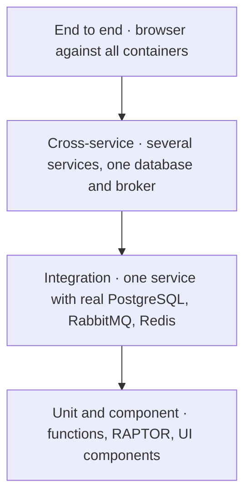

# Automated tests

> [!WARNING]
> **Work in progress.** The project is still being developed; numbers are from 2026-11-24.

## Contents

- [At a glance](#at-a-glance)
- [Strategy](#strategy)
- [Tools and why](#tools-and-why)
- [Run locally](#run-locally)
- [Names and directories](#names-and-directories)
- [Coverage](#coverage)
- [Techniques](#techniques)
- [Real dependencies and test doubles](#real-dependencies-and-test-doubles)
- [CI and quality gates](#ci-and-quality-gates)
- [Defects found by tests](#defects-found-by-tests)
- [Known gaps](#known-gaps)
- [Recommendations](#recommendations)

## At a glance

| | |
| --- | --- |
| Unit, component and integration tests | 417 in 75 files |
| End-to-end tests | 16 (Playwright) |
| Back-end coverage | 91.6 % lines, 80.5 % branches, 91.9 % functions |
| Whole repository | 79.0 % lines, 70.4 % branches, 73.3 % functions |
| Mutation score (9 critical modules) | 89.7 % |
| Evidence | [docs/evidence/tests.md](../docs/evidence/tests.md), [docs/evidence/load.md](../docs/evidence/load.md) |

## Strategy

Every level tests what the level below cannot see:

| Level | Checks | Where |
| --- | --- | --- |
| Unit | Routing, walking model, validation, tokens, passwords, parsing, error mapping; normal and edge cases | `*.test.ts` |
| Component | Forms, lists, guards, keyboard use of the web client | `apps/web/**/*.test.tsx` |
| Integration | Endpoints, permissions, SQL (constraints, triggers, procedures), outbox and inbox, configuration | `*.itest.ts` |
| Contract | Responses against OpenAPI, events against AsyncAPI; generated code up to date | integration tests, CI job `contracts` |
| Cross-service | Feed import → activation event → map → user history; account erasure; migrations on existing data | [tests/cross-service/](../tests/cross-service/) |
| End to end | User flows, accessibility, navigation | [tests/e2e/](../tests/e2e/) |
| Load | Success or a deliberate 503/429 under load, recovery afterwards | [tests/load/](../tests/load/) |

The services get most integration tests because much of their logic is SQL and messaging, which a
mock would only imitate.

## Tools and why

| Tool | Why |
| --- | --- |
| Vitest | One runner for services and web, TypeScript without a build, V8 coverage |
| Testcontainers | Real PostgreSQL + PostGIS, RabbitMQ and Redis per test file, thrown away afterwards |
| Testing Library | Components through what a user sees |
| Playwright, axe | Real browser, traces, accessibility rules |
| fast-check | Finds inputs nobody thought of |
| Stryker | Measures whether the tests notice broken code |
| k6 | Load from a container, no installation |

## Run locally

Node.js, pnpm (`corepack enable`, `pnpm install`) and Docker.

| Command | What |
| --- | --- |
| `pnpm test` | Unit and component tests (no Docker) |
| `pnpm test:int` | Integration and cross-service tests |
| `pnpm test:cov` | Both with coverage and thresholds; report in `coverage/index.html` |
| `pnpm test:mutation` | Mutation tests (about 5 minutes); report in `reports/mutation/index.html` |
| `pnpm e2e:up && pnpm e2e` | End-to-end tests; `pnpm e2e:down` removes the stack |
| `pnpm load capacity smoke`, `pnpm load rate-limit` | Load tests against the end-to-end stack |

## Names and directories

`*.test.ts(x)` unit and component, `*.property.test.ts` property-based, `*.itest.ts` integration:
next to the code they test. Whole-system tests are in `tests/cross-service`, `tests/e2e` and
`tests/load`; shared helpers in [packages/testing/](../packages/testing/); fixtures in
[fixtures/gtfs/testville/](../fixtures/gtfs/testville/) with hand-computed answers.

## Coverage

| Workspace | Lines | Branches | Functions |
| --- | --- | --- | --- |
| gateway | 92.5 % | 92.4 % | 91.7 % |
| identity | 91.8 % | 83.0 % | 95.7 % |
| transit-data | 92.2 % | 78.3 % | 96.4 % |
| accessibility | 93.2 % | 75.6 % | 93.3 % |
| places | 90.4 % | 87.8 % | 90.7 % |
| packages/common | 89.1 % | 81.2 % | 85.3 % |
| packages/contracts | 100 % | 90.0 % | 100 % |
| **Back end** | **91.6 %** | **80.5 %** | **91.9 %** |
| web (unit and component only) | 55.1 % | 56.8 % | 50.0 % |
| Everything | 79.0 % | 70.4 % | 73.3 % |

Every source file counts, also files no test imports. Left out: generated code, the tests and
their helpers. Thresholds: [vitest.config.ts](../vitest.config.ts).

## Techniques

- **FIRST:** unit tests run in seconds, share no state, and contain their own expected values.
- **Independent of the machine:** no assertion on speed; waits are for a condition, time limits
  only end a hanging test; test databases live in memory.
- **Property-based:** RAPTOR against a brute-force search on 2 000 random networks, pattern
  building, medians, distances, passwords.
- **Mutation testing:** Stryker on routing, requests, passwords, tokens, gateway authentication.
- **Regression first:** a fix comes with a test that fails without it.

## Real dependencies and test doubles

| Dependency | In tests |
| --- | --- |
| PostgreSQL, RabbitMQ, Redis | Real (Testcontainers), with the real roles and migrations |
| OSRM, geocoder, GTFS publisher, other services | Small HTTP servers that can fail, delay or answer fixed data |
| Browser APIs missing in jsdom, time | Fakes |

No module is mocked (`vi.mock` is not used): tests talk to the public interface, so refactoring does
not break them.

## CI and quality gates

[.github/workflows/ci.yml](../.github/workflows/ci.yml), on pull requests and on demand. A push to
`develop` or `main` runs only the linter.

| Gate | Fails when |
| --- | --- |
| Lint, types | any warning or error |
| Tests with coverage | a test fails, or back-end coverage is below 90 % lines / 78 % branches, or one workspace below 85 % / 70 % |
| Contracts | invalid, or generated code is out of date |
| Database | migrations up/down/up, seeds or smoke test fail |
| End to end | a test fails, or passes only on the second try; load scripts see an unexpected error |
| Mutation (on demand) | score below 85 % |

Reports (coverage HTML, JUnit, mutation) are artifacts of the run; the coverage table is on its
summary page.

## Defects found by tests

| Found by | Defect | Fixed |
| --- | --- | --- |
| Property test | RAPTOR could chain two footpaths after one trip, depending on stop order | yes |
| Load test | A connection closed by PostgreSQL during a transaction ended the whole service | yes |
| Load test | An overloaded database answered 500 instead of 503 with `Retry-After` | yes |
| Unstable integration test | A timetable was served before its transaction was committed | yes |
| Unstable e2e test | `?next=` lost on the way to sign-in | yes |
| e2e | Two quick reloads revoked all sessions | yes |
| e2e | The map had no height after its CSS became lazy | yes |
| Performance e2e | The map hung after its worker failed | yes |
| axe | Text contrast below 4.5:1 | yes |

## Known gaps

- **Web client 55 % lines:** pages, the map component and admin screens are covered by Playwright,
  which is not part of the measurement.
- **Entry points** (`main.ts`), **tracing start-up:** run only in containers; covered end to end.
- **Branches of `?? 0`:** required by strict indexing in TypeScript, unreachable at run time.
- **Surviving mutants (79 of 768):** mostly equivalent code (a check that only saves work) and
  texts of error messages.
- **Load tests** use the OSRM and geocoder stubs and the testville feed, not real Warsaw data.

## Recommendations

1. Merge Playwright coverage into the report.
2. Load test with real Warsaw data on the production server.
3. Failure drills as tests (stop RabbitMQ and OSRM during a run).
4. Visual regression of the map and the home page.
